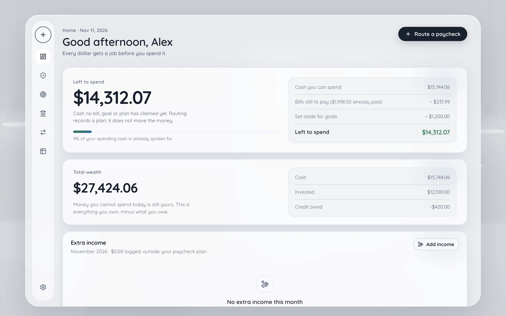

# WageRoute

**Zero-based paycheck routing for the desktop.**

[Website](https://revax-2007.github.io/wageroute/) · [Download](https://github.com/ReVax-2007/wageroute/releases/latest) · [Homebrew tap](https://github.com/ReVax-2007/homebrew-wageroute) · [Docs](docs/) · [Changelog](CHANGELOG.md)

WageRoute is a local-first personal finance ledger that puts every paycheck through the same order of operations:

1. **Protect the Priority Wall** — recurring bills are reserved before anything else moves.
2. **Split the true surplus** — savings, investments, sinking funds and debt payoff.
3. **Leave the remainder guilt-free** — leisure is the residual, so the plan can never spend money twice.

It is a planning and ledger tool, not a bank connection. There is no account linking, no cloud account, no telemetry and no sync. Everything lives in one SQLite file on the machine where you installed it — plus, only if you turn encryption on, a small key file beside it that holds no key in the clear.

<picture>
  <source media="(prefers-color-scheme: dark)" srcset="assets/screenshots/home-dark.webp" />
  
</picture>

> Version **1.3.1** · single user · macOS, Windows and Linux · unsigned release builds

> **Upgrading from 1.2.0 or older?** Encryption at rest, sealed backups and the phone vault first shipped in **1.3.1** (there was no published 1.3.0). An encrypted ledger cannot be opened by any build before 1.3.1, so if you might go back, keep a **plain** JSON backup first. Fingerprint, face and PIN unlock are on `main` but not in a release yet; they are marked *(next release)* below.

---

## Contents

- [What it does](#what-it-does)
- [Design rules](#design-rules)
- [Screens](#screens)
- [Technology](#technology)
- [Installing WageRoute](#installing-wageroute)
- [WageRoute Pocket](#wageroute-pocket)
- [Quick start](#quick-start)
- [Where your data lives](#where-your-data-lives)
- [Backup, export and import](#backup-export-and-import)
- [Deployment status](#deployment-status)
- [Project layout](#project-layout)
- [Documentation](#documentation)
- [Support](#support)
- [Contributing](#contributing)
- [License](#license)

---

## What it does

| Area | Behaviour |
| --- | --- |
| **Priority Wall** | Track rent, utilities, insurance and subscriptions with weekly through yearly cadences. Each bill is smoothed into a monthly equivalent and a per-paycheck reserve. Paused bills stop reserving money but stay in history. |
| **Paycheck allocator** | A three-step wizard: enter the deposit, subtract the wall, distribute the true surplus. Splits are percentages of the surplus, not of gross income. The result is committed as one paycheck record with allocation lines. |
| **Sinking funds** | Named goals with targets, optional deadlines and priorities. The allocator funds them in priority order, then by deadline, then by name. Fully funded goals stop taking money. Unused goal budget sweeps into savings. A goal can be given a dedicated account, whose balance *is* the progress; every other goal counts allocation lines. |
| **Emergency fund** | A special sinking fund with an automatic target: monthly essentials × 3–6 months. Essentials are the Priority Wall plus, optionally, the average of recent variable expenses. A manual target mode is also available. |
| **Accounts and credit** | Checking, savings, cash, investment and credit accounts, grouped by institution. Balances are derived from entries. Credit cards store debt as a negative balance and expose a utilization meter against their limit. Each account declares whether it counts as spendable, and can be marked as reserved for one goal. |
| **Total wealth** | Everything owned on one strip: cash, money parked in dedicated goal accounts and investments, minus credit owed. Shown on the Home page, as an Accounts summary tile and in the sidebar. All three read the same shared function, so they cannot disagree. A daily snapshot history draws a net-worth sparkline on Home once a second day exists. |
| **Card terms and payoff** | A credit card can carry its APR, minimum payment, statement close day, payment due day and last statement balance. The Accounts row then shows what is due on which date and how long the balance takes to clear at the minimum — or says plainly that the minimum never clears it. |
| **Categories and spending** | Entries point at a real category row. The grid and the entry dialog complete existing names, renaming a category relabels its entries, and Home totals the month's spending by category. |
| **Spreadsheet** | A server-queried ledger: search, date range, account, kind, category and sort filters, 100 rows a page, select-and-delete in bulk, and in-place editing of date, account, kind, category, description and amount. A second tab projects bills and goal deadlines over the next 90 days. |
| **Round-up** | Tangerine-style spare-change sweeps: when an expense is logged against a checking or cash account, the difference to the next $1, $2 or $5 is moved to a savings account as a paired transfer. |
| **Paired transfers** | Account-to-account moves are written as two linked rows sharing a `transfer_group_id`. Editing an amount, date, memo or category updates both legs. Deleting either leg removes both. |
| **Chronology prompts** | Active bills past their latest due date with no matching `bill_id` payment are surfaced on the dashboard as “Did this clear?” prompts with one-click logging. A bill marked **autopay** is recorded automatically at the next launch after its due date instead, so the wall clears itself. |
| **Data portability** | Full or partial JSON backups, a whole-ledger CSV export, and imports that merge either format by row identity. A JSON backup is written either plain — readable by any spreadsheet — or sealed under a passphrase nobody can read without. Bank statements (OFX/QFX, QIF, or a CSV with no account column) import into the account you name; loan and investment statements are read for what they can offer. A bank line that carries a reference is never added twice, and a statement that carries a closing balance can be reconciled against the ledger. |
| **Data folder** | Optionally keep the ledger in a folder you choose — a NAS share, an external disk, or a synced folder — so several computers read the same data. The default per-user folder is unchanged; a chosen folder is locked to one writer at a time, uses rollback journaling, and keeps a safety copy on every move. With encryption on, the key file travels with the folder. |
| **Encryption at rest (opt-in)** | Settings can rewrite the ledger as ciphertext — chacha20 through the SQLite cipher driver — and take it back to plaintext from the same screen. The key is held by whoever you choose: this computer's keychain, a passphrase, or both. *(Next release:)* an opt-in PIN of six or more digits, which warns that anyone with a copy of the file can try every PIN offline, and fingerprint or face unlock through a passkey where the system supports it (in practice Windows Hello; Mac Touch ID needs a signed build). A passkey is never allowed to be the only way in. Changing who holds the key re-wraps 32 bytes and touches no page, so custody is adjustable after the fact. Nothing is encrypted unless asked, and a forgotten passphrase or PIN has no reset, no escrow and no support path. |
| **Pocket (phone)** | An optional installable web app that opens a backup and works as a peer of the desktop: it shows Safe to Spend, bills, goals, accounts and the ledger, and edits them offline through the desktop's own validation rules — including a card's owed balance and a card payment. It keeps a full copy of the tables in the browser, reuses the desktop's money functions, and merges with the desktop in both directions by exporting the tables it now holds. Its own copy can be sealed under a phrase of its own, and *(next release)* opened with a PIN or a fingerprint/face passkey as well. No server, account or upload. |
| **Transfers** | One screen to move money between accounts: pick the two accounts and the amount, see both balances before and after, and save one paired transfer. |
| **Appearance** | Dark, light or system theme. The resolved palette is cached locally to prevent a flash on launch. Motion is decoration: both devices obey the operating system's reduce-motion request, every control shows a keyboard focus ring, and the phone's browser bar follows the theme the page is actually painting. |

## Design rules

These are product and engineering constraints, not aspirations.

1. **Bills first.** The Priority Wall is funded before any percentage split is calculated. If a paycheck cannot cover the wall, all other buckets are zero and the plan reports a shortfall.
2. **Money is integer cents.** SQLite stores `INTEGER` cents. Floats never enter the ledger. Division by 100 happens only at display or export boundaries.
3. **The ledger is the source of truth.** Account balances are `starting_balance + SUM(entries)`. A correction is an adjustment row, never a silent overwrite.
4. **Routing is an envelope plan, not a bank transfer.** Committing a paycheck records income and allocation lines; it does not move money between accounts. Transfers and round-ups are separate, explicit ledger entries.
5. **Deletes are soft.** Rows get `deleted_at` tombstones so history and future sync stay coherent.
6. **Imports only add.** Existing rows and existing settings win. The one exception is a restore into a profile with no history, which adopts the file's settings. Nothing local is removed by an import.
7. **Local by default.** No server, no network calls in application code, no analytics, no auto-update.
8. **Deterministic domain logic.** The allocator, account and wealth rules, cadence maths, emergency calculator, projections and bill prompts are pure functions in `src/shared`, covered by Node tests.
9. **A dedicated account is the exception to rule 4.** Marking an account "only for" a goal makes its balance the goal's progress, and takes it out of the spendable pool so the same money is never counted twice. [ADR 0007](docs/decisions/0007-dedicated-accounts-balance-is-progress.md) records why, and what it costs.
10. **Encryption is offered, never imposed.** The ledger is plaintext on disk unless the owner turns it on, and turning it off again is the same screen. Every option states what it does not stop, and custody can be changed without rewriting a page. [ADR 0029](docs/decisions/0029-encryption-is-a-choice-on-the-disk-and-on-the-way-out.md) records why an opt-in, and why it is not an app lock.

## Screens

| Screen | Purpose | Key formulas |
| --- | --- | --- |
| **Home** | Left to spend hero, total wealth strip, accounts, month-to-date donut, last routing, goal progress, recent activity, bill prompts | `spendable pool − monthly wall − pool-funded goals − unsettled routing`; `Σ balances − credit owed` |
| **Bills** (the Priority Wall) | Bill CRUD, pause/resume, per-paycheck and monthly totals | `amount × bill periods / 12`; `amount × bill periods / pay periods` |
| **Goals** (sinking funds) | Goal CRUD, progress, emergency calculator | `funded / target`; dedicated goals read `account balance`; `essentials × months` |
| **Accounts** | Bank-grouped account CRUD, purpose and safe-to-spend choices, balance adjustments, credit payments | `starting + SUM(entries)`; `max(0, −balance)` owed |
| **Transfers** | Move money between two accounts in one step | two rows sharing one `transfer_group_id` |
| **Spreadsheet** | Editable ledger and 90-day projection | `next due date`, `advance by frequency` |
| **Settings** | Theme, round-up, import/export, data folder, encryption at rest and key custody, About | `remainder to next increment` |

The paycheck allocator is a full-screen wizard opened with **Route a paycheck** in the sidebar or on Home, not a separate navigation tab.

## Technology

| Layer | Choice |
| --- | --- |
| Shell | Electron 45 |
| Build | electron-vite 6, Vite 8 |
| UI | React 19.3, TypeScript 7 (strict), Zustand 5 |
| Grid | react-data-grid 7 |
| Icons | lucide-react |
| Database | better-sqlite3-multiple-ciphers 13 (the fork of better-sqlite3 that carries the cipher); SQLite in WAL mode, or rollback journaling in a data folder you choose |
| Key custody | Opt-in. Electron `safeStorage` for the device wrap (answers to the OS login, not a fingerprint); scrypt + AES-256-GCM for a passphrase, and *(next release)* for a PIN; a WebAuthn PRF passkey for fingerprint or face *(next release)* |
| Packaging | electron-builder 26 (DMG, NSIS, portable, zip, AppImage, deb, rpm) |
| Tests | `node:test` through `tsx` |
| CI | GitHub Actions: `verify` on Ubuntu for every pull request (lint, tests, build, Pocket build, packaging dry run); a version tag builds the macOS, Windows and Linux installers into a draft release |

The renderer is sandboxed with `contextIsolation: true`, `nodeIntegration: false` and `sandbox: true`. It reaches the main process only through the typed `window.api` bridge.

## Installing WageRoute

**One command (quickest).** Each script picks the right build for your system, checks it against the release's `SHA256SUMS`, installs it, and clears the "downloaded from the internet" block, so the first launch opens without the Gatekeeper or SmartScreen step.

```bash
# macOS and Linux
curl -fsSL https://revax-2007.github.io/wageroute/install.sh | sh
```

```powershell
# Windows (PowerShell)
irm https://revax-2007.github.io/wageroute/install.ps1 | iex
```

- **macOS:** the Apple Silicon or Intel DMG, copied into `/Applications` (or `~/Applications` if that is not writable).
- **Linux:** the `.deb` through apt or the `.rpm` through dnf/zypper (asks for your password), otherwise the AppImage in `~/.local/bin` with a menu entry.
- **Windows:** the Setup installer, silently, for the current user.

Options: `sh -s -- --dry-run` (download and verify only), `--version v1.3.1`, and on Linux `--appimage`. On Windows set `$env:WAGEROUTE_DRY_RUN = '1'` or `$env:WAGEROUTE_VERSION` before piping. Neither script touches your ledger. The manual routes below do the same steps by hand.

The macOS build is ad-hoc signed, not notarized. The first launch of any downloaded copy needs one extra click (right-click the app → **Open** → **Open**); after that it opens normally. Homebrew verifies checksums for you, and the curl one-liner below avoids the prompt entirely because curl never sets the quarantine flag.

**Homebrew (recommended, macOS):**

Install and update through the official [`homebrew-wageroute`](https://github.com/ReVax-2007/homebrew-wageroute) tap:

```bash
brew tap ReVax-2007/wageroute
brew install --cask wageroute          # first launch still needs right-click → Open
brew upgrade --cask wageroute          # future updates
```

The tap is updated after each release; `brew info --cask wageroute` shows which version it currently carries. Homebrew verifies the DMG against a pinned SHA-256 before installing. To drop the Gatekeeper flag after installing, run `sudo xattr -rd com.apple.quarantine /Applications/WageRoute.app`. `brew uninstall --cask wageroute` removes the app but leaves your data in place.

**DMG (manual):** download `WageRoute-<version>-arm64.dmg` (Apple Silicon) or `WageRoute-<version>-x64.dmg` (Intel) from [GitHub Releases](https://github.com/ReVax-2007/wageroute/releases), drag to Applications, then right-click → **Open** on first launch. (1.1.0 named its Intel file `WageRoute-1.1.0.dmg`; later releases carry the `-x64` suffix.)

**curl (no Gatekeeper prompt at all):** browsers tag downloads with a quarantine flag that triggers Gatekeeper; curl does not. The commands below fetch **1.3.1**; for a later release, change the version from [GitHub Releases](https://github.com/ReVax-2007/wageroute/releases). Intel Macs use `-x64.dmg` in place of `-arm64.dmg`.

```bash
curl -LO https://github.com/ReVax-2007/wageroute/releases/download/v1.3.1/WageRoute-1.3.1-arm64.dmg
hdiutil attach -nobrowse -mountpoint /tmp/wageroute-dmg WageRoute-1.3.1-arm64.dmg
cp -R /tmp/wageroute-dmg/WageRoute.app /Applications/
hdiutil detach /tmp/wageroute-dmg
```

**Windows:** four formats, all unsigned — the NSIS installer (`WageRoute.Setup.<version>.exe`, universal for Intel and ARM), an MSI (`WageRoute-<version>-x64.msi` or `-arm64.msi`) for managed deployment, a portable single-file exe (`WageRoute-<version>.portable.exe`), and an unpack-and-run zip per architecture.

Because the executables are currently unsigned, Windows and web browsers apply two layers of security warnings:
1. **Browser download prompt:**
   - **Microsoft Edge:** flags the download as untrusted (*"WageRoute.Setup.exe was blocked because it could harm your device"*). Hover over the item in the Downloads list → click **`...`** → **Keep** → click **Show more** → select **Keep anyway**.
   - **Google Chrome:** click the download warning icon → select **Download suspicious file** (or **Keep**).
2. **Windows SmartScreen execution check:**
   - Double-clicking the downloaded `.exe` opens a blue *"Windows protected your PC"* window.
   - Click **More info** → click **Run anyway**.
   - Alternatively, right-click the downloaded file → **Properties** → check the **Unblock** box at the bottom → **OK**, or in PowerShell: `Unblock-File -Path "$env:USERPROFILE\Downloads\WageRoute.Setup.1.3.1.exe"`.

**PowerShell / curl (avoids the browser quarantine and SmartScreen block entirely):**
```powershell
curl.exe -LO https://github.com/ReVax-2007/wageroute/releases/download/v1.3.1/WageRoute.Setup.1.3.1.exe
.\WageRoute.Setup.1.3.1.exe
```

*Note on MSI vs NSIS:* The MSI and the NSIS installer are separate products. Uninstall one before installing the other, or Windows will list both.

**Linux:** AppImage (standalone, runs on any distro), plus native `.deb` (Debian, Ubuntu, Linux Mint) and `.rpm` (Fedora, RHEL, openSUSE) packages in x64 and arm64.

- **AppImage:** Make the downloaded file executable before launching:
  ```bash
  chmod +x WageRoute-1.3.1-x86_64.AppImage
  ./WageRoute-1.3.1-x86_64.AppImage
  ```
  *Note on Ubuntu 22.04+ & 24.04+:* Modern Ubuntu installs do not ship FUSE 2 by default. If the AppImage gives an error loading `libfuse.so.2`, install it with `sudo apt install libfuse2t64` (Ubuntu 24.04+) or `sudo apt install libfuse2` (Ubuntu 22.04), or run with `--appimage-extract-and-run`.
- **Debian / Ubuntu (.deb):**
  ```bash
  sudo apt install ./WageRoute-1.3.1-amd64.deb
  ```
- **Fedora / RHEL (.rpm):**
  ```bash
  sudo dnf install ./WageRoute-1.3.1-x86_64.rpm
  ```
- **curl one-liner (AppImage):**
  ```bash
  curl -fsSL https://github.com/ReVax-2007/wageroute/releases/download/v1.3.1/WageRoute-1.3.1-x86_64.AppImage -o WageRoute.AppImage && chmod +x WageRoute.AppImage && ./WageRoute.AppImage
  ```

Full details, including the Gatekeeper behaviour on each macOS version, are in [docs/DEPLOYMENT.md](docs/DEPLOYMENT.md) and [docs/RELEASING.md](docs/RELEASING.md).

**Docker (neither half is an installer, and no release needs these):** the repository ships a container for each app, built from source in the image.

```bash
docker compose up --build
# Pocket   http://localhost:8173
# Desktop  http://localhost:6080/vnc.html?autoconnect=true
```

Pocket is the static phone app served by nginx, with the headers a plain file drop forgets. The desktop container is **not** a web version of the app: it runs the real Linux build against a virtual display and streams that window to your browser, so there is one shared session watched through a websocket, the ledger lives in a named volume — with its key file, if encryption is on, in that same volume — and Chromium's sandbox is off. A container has no keychain, so a ledger encrypted there can only be held by a passphrase. Read the caveats in [docs/DEPLOYMENT.md](docs/DEPLOYMENT.md#running-wageroute-in-a-container) before pointing it at a real ledger.

There is a third shape for people who want a phone or a second person to reach it: `docker-compose.yml`'s `edge` profile puts Caddy in front with TLS and a forward-auth login, plus one pair of containers and one volume per person. Neither the certificate nor the login is in the app — [ADR 0030](docs/decisions/0030-self-hosting-puts-identity-at-the-edge.md) decides they stay at the edge — and the default `docker compose up` starts exactly the two loopback containers it started before. The command, the fail-closed rules and what is still unproven are in [docs/DEPLOYMENT.md](docs/DEPLOYMENT.md#tls-a-login-and-more-than-one-person).

## WageRoute Pocket

Pocket is the optional phone app: an installable static web app built from `src/pocket`. It opens a backup from the computer, keeps those tables in the browser, edits them offline through the desktop's own validation rules, and exports the result for the desktop to merge. No account, no server, no analytics, no upload — you carry the file, and it never leaves the phone except in your own hands.

**Using it** — the full guide is [docs/POCKET.md](docs/POCKET.md):

1. **Put the app on an HTTPS origin.** [`pocket.yml`](.github/workflows/pocket.yml) builds `dist-pocket/` and deploys it to GitHub Pages, or serve that folder from any static host you trust, or run the container the repository ships: `docker build -f docker/pocket.Dockerfile -t wageroute-pocket . && docker run --rm -p 127.0.0.1:8173:80 wageroute-pocket`. On the machine running that container `localhost` counts as a secure origin, so the offline shell is available there — but the `-p 127.0.0.1:` binding means a handset cannot reach that container at all. To serve a phone, republish the port on your LAN address and put TLS in front; plain HTTP on a LAN address gives no service worker, no install prompt and no cipher at all. Publishing is a deliberate owner action. GitHub Pages on this repository already serves the project website from `main`, and `pocket.yml` deploys through GitHub Actions, which would replace that site, so host Pocket on its own static host or one of the containers instead.
2. **Install it on the phone.** Open the address in Chrome (Android) or Safari (iPhone), then **Install app** from the browser menu, or Share → **Add to Home Screen**. From then on it opens as its own app, with the signal off.
3. **Give it your ledger.** On the computer: Settings → **Export full backup**. Send that file to the phone and choose it on the welcome screen. A sealed one is offered a passphrase and stays shut without it — nothing about its contents is counted until it opens. The file is checked before it opens — an unknown kind or frequency, or money that is not a whole number of cents, is refused rather than quietly replaced.
4. **Work in the six tabs.** Home, Bills, Goals, Accounts, Entries, Data. A bill you **Mark paid** here closes its paycheck's set-aside on this phone, in the same keystroke the desktop would; a save the desktop would refuse is refused here, in the same words, and nothing is written.
5. **Carry the changes back.** Data → **Export a backup**, then import that file on the computer with Settings → **Import data**: rows added on the phone arrive, the phone's newer edits win, its deletions are applied. Opening a newer backup on the phone merges instead of replacing, so entries typed there between files survive.

6. **Seal what it holds, if you want.** Data → **Seal this phone's copy** puts the phone's own tables under a passphrase of its own — separate from the desktop's, and separate from the one on an exported file. *(Next release:)* a PIN and a fingerprint or face passkey can open the same sealed copy, while the passphrase always stays as the way back in. **Close it now** shuts the copy between sessions; nothing on it is readable until it is opened again. It is not a screen lock: an unlocked tab holds the same data sealed or not. And the cipher is a privilege of the origin — a page served over plain HTTP has no cipher at all, so sealing and opening are refused there instead of half-working. Serve Pocket over HTTPS, or from the machine it runs on.

Paychecks, allocations, the routing plan, settings and the writing of a paycheck's set-aside stay on the computer and arrive with the next backup; whether that set-aside has been spent is not one of them — the phone derives it from the payments it holds. Merge by hand means one habit matters: carry the file after each session, because the newer row wins and the older edit is dropped without a conflict screen.

Build and run it with `npm run pocket:dev`, `npm run pocket:build`, and `npm run pocket:preview`. It is not part of the desktop installers. The two-way merge rule is [ADR 0024](docs/decisions/0024-two-copies-merge-by-time.md), the shared validation is [ADR 0025](docs/decisions/0025-the-phone-writes-through-the-desktops-own-rules.md), the shared claim derivation is [ADR 0028](docs/decisions/0028-both-devices-derive-a-bills-set-aside-from-its-payments.md), and the choice to make the phone's copy sealable is [ADR 0029](docs/decisions/0029-encryption-is-a-choice-on-the-disk-and-on-the-way-out.md). **Honest status:** every screen has been driven over the Chrome DevTools Protocol against the built bundle, and no real handset has run it yet — including the vault, whose unlock speed on a phone CPU has never been measured.

## Quick start

Requirements: **Node.js 22 or newer** (CI uses 24) and npm. macOS packaging expects Xcode Command Line Tools; Windows packaging is normally done on Windows or in CI, and the MSI target only builds on Windows because it needs WiX.

```bash
npm install          # uses the cipher fork's prebuilt N-API binary — nothing is compiled
npm run dev          # launch the app with hot reload
npm test             # domain, accounts, import-repair, backup and repository tests
npm run lint         # repository lint gate: no debugger, console logging, @ts-ignore or any
npm run typecheck    # main/preload, renderer and Pocket type checks
npm run build        # typecheck + production bundles in out/
npm run pocket:dev   # Pocket in a phone-sized browser with hot reload
npm run pocket:build # static Pocket files in dist-pocket/
npm run screenshots  # after a build: retake the website's screenshots on the demo profile
npm run dist:mac     # DMG for arm64 and x64
npm run dist:win     # NSIS, MSI, portable exe and zip for x64 and arm64 (MSI needs Windows)
npm run dist:linux   # AppImage, deb and rpm for the host architecture
```

`npm run dev` seeds a demo profile (Alex, with accounts, bills, goals, paychecks and transactions) the first time it launches, so every screen is explorable. Packaged builds are different: first launch creates an empty profile and the dashboard offers **Start from scratch** or **Import a backup**. In both cases the seed never runs again once a user row exists.

## Where your data lives

The database file is `wageroute.db` under Electron's per-user data directory:

| Platform | Path |
| --- | --- |
| macOS | `~/Library/Application Support/WageRoute/wageroute.db` |
| Windows | `%APPDATA%\WageRoute\wageroute.db` |
| Linux | `~/.config/WageRoute/wageroute.db` |

SQLite also creates `wageroute.db-wal` and `wageroute.db-shm` while the app is open. Copy all three together if you copy the database while WageRoute is running.

With encryption on, the same folder holds one more file: `ledger.key.json`, a few hundred bytes that carry the ledger's key **wrapped** — never in the clear — and are readable only by WageRoute (`0600`). It is the other half of the ledger: a keyed `wageroute.db` copied without its key file opens nowhere, and a key file without its ledger is inert. **Copy the folder, not the file.** Moving the data folder from inside the app carries the key file along with the ledger.

A keyed database is not a SQLite file any older build can read — `1.2.0` and earlier refuse it as unreadable, so it is a one-way move unless you also keep a **plain** JSON backup, which is the only copy that survives switching builds back.

The app was previously named **Cash Flow Routing**. On first launch, if the new database does not exist, WageRoute copies `Cash Flow Routing/cash-flow-routing.db` (plus WAL and SHM) into the new folder and leaves the original untouched. See [docs/DEPLOYMENT.md](docs/DEPLOYMENT.md#legacy-data-adoption).

## Backup, export and import

- **Export full backup** writes every row of accounts, balance snapshots, categories, bills, goals, paychecks, allocations, bill reserves, transactions and settings as JSON, tagged with backup version 10. It includes tombstones and all linked IDs, and an older backup (version 2 or later) still restores. The dialog offers the file **two ways**: plain JSON, which any spreadsheet opens, or the same contents sealed under a passphrase — AES-256-GCM under a key stretched with PBKDF2-HMAC-SHA256, written as `wageroute-backup-<stamp>-encrypted.json`, which WageRoute on the phone opens with that phrase and nobody else can read. Nothing recovers a lost phrase: the file is then a puzzle with one piece missing.
- **Export transactions CSV** writes the **whole** ledger — not the 500-row screen snapshot — with Date, Account, Institution, Kind, Category, Description, Amount and Currency. It is always plaintext, and it is a report rather than a backup. Both exports are written owner-only (`0600`).
- **Import data** accepts a backup (plain or sealed), an entries CSV, a bank statement (OFX/QFX or QIF) or a CSV with no account column, and walks you through a three-step wizard — four, when the file arrives sealed and has to be opened first. JSON may contain only some tables. CSV is treated as entries and matched to local accounts by name (optionally narrowed by institution); a statement is imported into the one account you pick, and a transaction the bank identifies with a FITID (or a CSV reference) is never added twice. When the statement carries a closing balance it is compared with your ledger, and one adjustment is offered if the two disagree.
- **The wizard asks instead of failing.** Anything a row is missing, mis-typed, out of range or pointing at — plus CSV account names that match nothing — is put to you as a question with a fix-or-leave-out choice. Rows you cannot fix are left out with an explanation of what was wrong and how to repair the file; the rest of the import still lands.
- Imports merge by row identity: a row the file holds a newer version of replaces the local copy, an older copy is skipped, and a newer tombstone deletes. Settings merge per key the same way once the ledger has history; a backup restored into an empty profile also supplies its settings. Re-importing the same file changes nothing.

Full format rules, examples and failure modes are in [docs/IMPORT-EXPORT.md](docs/IMPORT-EXPORT.md).

## Deployment status

**WageRoute is local-only today.** There is no sync engine, no cloud backup, no hosted service, no user account and no automatic updates. The installers contain no listening port at all; the two container images are the only way this project runs something on a port, and both publish to `127.0.0.1` by default. The optional data folder can sit on a drive the user already syncs, but WageRoute itself does not coordinate that sync. Multi-device use otherwise requires exporting and importing files manually. The schema is deliberately sync-ready, but no sync design has been agreed or implemented.

**Encryption is the same kind of local.** It is opt-in, it is reversible from the same screen, and every part of it stays on the machine: a wrapped key in the ledger's own folder, the OS keychain for the device wrap, or the passphrase in the owner's head. There is no hosted key, no escrow, no reset and no support path that can open a locked ledger — losing the only custody there is means the data is gone, and the app says so before it lets you choose it. The transition rewrites every page, and it has now run end to end in the **packaged** macOS app: encrypted from Settings, restarted into the unlock prompt, opened with the passphrase, turned back to plaintext again. What an installed build has still never done is write a **device** wrap, and no Windows or Linux artifact has held a keyed ledger.

**Pocket is static.** Its build is a folder of files with no backend; deployment means publishing those files to a static host. The repository includes a manual GitHub Pages workflow, but this repository's Pages already serves the project website, so Pocket is published somewhere else or not at all; either way it is a deliberate owner action and not part of a release. It has never been installed on a real handset: every screen, refusal and round trip has been proved in a browser against the built bundle.

The CI workflow builds unsigned installers; on a tag it attaches them to a **draft** GitHub Release but never publishes it. Publishing the release is a manual step. Code signing and notarization are not configured.

The two container images build and run locally — Pocket serves the same hash-named bundle `npm run pocket:build` writes and every response header has been checked one by one, and the desktop session has been watched and driven in a browser — but the in-container **install prompt** has never been exercised, no handset has opened either URL, and the workflow that would publish them to `ghcr.io` has never run and no image has been pushed. Publishing an image is a deployment, not a release: see [docs/RELEASING.md](docs/RELEASING.md#container-images).

See [docs/DEPLOYMENT.md](docs/DEPLOYMENT.md) for the full status matrix and the GitHub vs GitLab recommendation, and [docs/RELEASING.md](docs/RELEASING.md) for the build and release checklist.

## Project layout

```text
.
├── .github/workflows/         CI, release builds, Pocket and container publishing
├── assets/                    Website CSS, JS, screenshots and link-preview image
├── build/                     App icon sources and generated .icns/.png
├── docker/                    Pocket nginx image, streamed desktop image, entrypoint, supervisor, edge Caddyfile
├── docker-compose.yml         Both images, one command, published to 127.0.0.1; the `edge` profile adds TLS + a login
├── docs/                      Documentation (this set)
├── examples/                  Example backup used by the importer tests
├── index.html                 The project website (GitHub Pages serves main's root)
├── scripts/                   Lint, test-list guard, licence notices, screenshots
├── sitemap.xml                Sitemap for the website
├── spikes/                    Measured experiments cited by ADRs (not shipped)
├── out/                       electron-vite build output (ignored)
├── release/                   electron-builder output (ignored)
├── dist-pocket/               Pocket static build output (ignored)
├── src/
│   ├── main/                  Electron main process
│   │   ├── db/                connection, migrations, repositories, backup,
│   │   │                      entries import, key custody and the encrypt/
│   │   │                      decrypt transition, legacy adoption, seed
│   │   ├── index.ts           app lifecycle, window, security policy
│   │   └── ipc.ts             IPC handlers and file dialogs
│   ├── preload/               contextBridge surface
│   ├── renderer/              React application
│   │   ├── index.html         CSP and document title
│   │   └── src/
│   │       ├── components/    Sidebar, grids, prompts, dialogs, shared table
│   │       ├── lib/           Renderer-side derived finance helpers
│   │       ├── screens/       Dashboard (Home), PriorityWall (Bills), Goals,
│   │       │                  Accounts, Transfers, Spreadsheet, Settings,
│   │       │                  Allocator
│   │       ├── store/         Zustand slices, actions and selectors
│   │       └── styles/        tokens, layered sheets, grid theme
│   ├── pocket/                Static installable phone app
│   │   ├── lib/               backup reader, snapshot, store, IndexedDB, sealed
│   │   │                      vault and envelope, WebCrypto guard, install
│   │   ├── components/        Sheet, field, money and percent inputs, nav, delete
│   │   │                      confirm, vault card, seal and unlock sheets
│   │   ├── screens/           Home, Bills, Goals, Accounts, Ledger, Data, Welcome
│   │   └── public/            manifest, service worker, icons
│   └── shared/                Pure domain layer used by all processes
│       ├── allocator.ts       Paycheck routing algorithm
│       ├── accounts.ts        Safe-to-spend membership, total wealth, buckets
│       ├── cadence.ts         Bill/pay frequency smoothing
│       ├── emergency.ts       Emergency fund calculator
│       ├── encryption.ts      Custody options and the honesty table they carry
│       ├── envelope.ts        Sealed backup format, shared by both devices
│       ├── csv.ts             CSV export and import parsing
│       ├── qif.ts             QIF record reader
│       ├── statements.ts      OFX/QFX and bank CSV statement readers
│       └── types.ts           Shared TypeScript contracts
├── electron-builder.yml       Packaging targets
├── electron.vite.config.ts    Build config and aliases
└── package.json
```

## Documentation

| Document | What it covers |
| --- | --- |
| [docs/ARCHITECTURE.md](docs/ARCHITECTURE.md) | Process model, boot sequence, IPC, state flow, module responsibilities |
| [docs/DATA-MODEL.md](docs/DATA-MODEL.md) | Every table, column, index, invariant, settings key and migration |
| [docs/FEATURES.md](docs/FEATURES.md) | Screen-by-screen behaviour and the exact formulas behind each number |
| [docs/POCKET.md](docs/POCKET.md) | Using the phone app: getting it installed, first run, the six tabs, sealing the phone's copy, carrying files between devices, what is refused, and what has not been proved yet |
| [docs/IMPORT-EXPORT.md](docs/IMPORT-EXPORT.md) | JSON backup schema, sealed exports, partial imports, CSV grammar, dedupe and errors |
| [docs/DEPLOYMENT.md](docs/DEPLOYMENT.md) | Local-only reality, multi-device options, running either app in a container, TLS and a login at the edge, key custody there, sync status, repo hosting |
| [docs/DEVELOPMENT.md](docs/DEVELOPMENT.md) | Setup, scripts, feature checklist, migration recipe, debugging |
| [docs/RELEASING.md](docs/RELEASING.md) | Versioning, packaging, CI, signing gaps, release and rollback |
| [docs/SECURITY.md](docs/SECURITY.md) | Trust boundaries, controls, encryption at rest and key custody, threats, known gaps |
| [CHANGELOG.md](CHANGELOG.md) | What changed in each release, and what landed after the last one |
| [docs/UNRELEASED.md](docs/UNRELEASED.md) | The running queue for the next release, its blockers and its checklist |
| [docs/decisions/README.md](docs/decisions/README.md) | Architecture decision records for the load-bearing choices |

Related repositories: [ReVax-2007/homebrew-wageroute](https://github.com/ReVax-2007/homebrew-wageroute) — the official Homebrew tap (cask, install/update docs); bumped to each release per [docs/RELEASING.md](docs/RELEASING.md#release-checklist).

## Support

WageRoute is free, with no account, no telemetry and no paid tier. If it earns its place in your month, you can buy me a coffee — the same link is in the app under **Settings → About**.

[](https://buymeacoffee.com/revax)

## Contributing

Work on a separate branch and open a pull request; never push directly to `main`. Before requesting review, run `npm run lint`, `npm test`, `npm run typecheck` and `npm run build`. Do not commit databases, backups, CSV exports or real financial data. Full branch, review and data-safety standards are in [CONTRIBUTING.md](CONTRIBUTING.md).

## License

WageRoute is **source-available, not open-source**. See [LICENSE](LICENSE). You may use, study and modify it, including commercially, on machines you control, and keep your modifications private. You may not sell it, sublicense it, or distribute builds or modified versions — only the licensor ships WageRoute. Contributions may be pushed on a separate branch and are accepted through a pull request; submitting one grants the licensor permission to include it.
