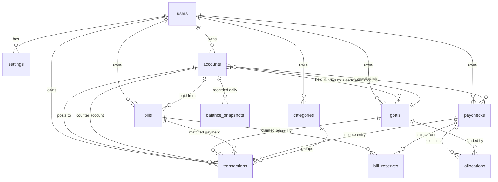

# Data model

WageRoute stores every financial fact in one SQLite database, `wageroute.db`, using `STRICT` tables, integer cents, UUID text keys and ISO-8601 timestamps. This document describes the schema at version 11, the semantics of each column, the derived values the app computes at read time, and the invariants that keep the ledger coherent.

That one file is the ledger, not the whole installation. Beside it live `ledger.key.json` (only the wraps that can produce the ledger's key, when the owner turns encryption on) and, in the app's own folder, `storage.json` (which folder to use) and `backups/` (the daily and pre-upgrade copies). The phone keeps its own copy of these same tables in IndexedDB. Nothing in the schema records any of it — see [Encryption is not schema state](#encryption-is-not-schema-state).

Source of truth: [`src/main/db/migrations.ts`](../src/main/db/migrations.ts). Read model assembly: [`src/main/db/repo/read-models.ts`](../src/main/db/repo/read-models.ts).

---

## Contents

- [Conventions](#conventions)
- [Entity relationships](#entity-relationships)
- [Tables](#tables)
- [Indexes](#indexes)
- [Derived values](#derived-values)
- [Settings keys](#settings-keys)
- [Encryption is not schema state](#encryption-is-not-schema-state)
- [Migrations](#migrations)
- [Invariants](#invariants)
- [Retention and soft deletes](#retention-and-soft-deletes)
- [Limits and exclusions](#limits-and-exclusions)
- [Sync-readiness](#sync-readiness)

---

## Conventions

| Concern | Rule |
| --- | --- |
| Identity | UUIDv4 text generated on-device by `randomUUID()` |
| Money | `INTEGER` cents. No floats, no mixed-currency columns |
| Dates | `YYYY-MM-DD` text, no time or zone |
| Timestamps | ISO-8601 UTC text, e.g. `2026-10-27T18:22:04.871Z` |
| Deletes | Soft: `deleted_at` is set, rows remain |
| Change tracking | `revision` increments on every update and soft delete |
| Tenant key | `user_id` on every financial table |
| Storage | SQLite `STRICT` tables; booleans are `INTEGER` constrained to 0/1 |
| Foreign keys | Enforced per connection (`PRAGMA foreign_keys = ON`) |
| Table names | Plural snake_case |
| Column names | Snake_case; repositories alias to camelCase for TypeScript |

### Sign conventions

There is no database-level sign constraint on `transactions.amount_cents`. Direction is carried by the sign and intent by `kind`:

| Kind | Typical sign | Meaning |
| --- | --- | --- |
| `income` | positive | Money in |
| `expense` | negative | Discretionary spending |
| `bill_payment` | negative | Priority Wall bill paid |
| `transfer` | one negative, one positive | Paired account move |
| `goal_funding` | positive or negative | Manual goal-related entry; does not change goal progress |
| `investment` | positive or negative | Investment contribution/withdrawal |
| `adjustment` | either | Balance correction |

The UI normalises income to positive and expense/bill payment to negative when creating entries. The repository accepts any non-zero signed amount for every kind, because imports and adjustments need that freedom.

## Entity relationships



Cardinality in practice: one local user, many accounts/bills/goals/paychecks/transactions; each paycheck has zero or more allocation rows; each transaction optionally references a bill, goal, paycheck and counter-account.

## Tables

### `users`

The local profile. Exactly one active row is expected; the app never creates a second user.

| Column | Type | Constraints | Notes |
| --- | --- | --- | --- |
| `id` | TEXT | PK, NOT NULL | UUID |
| `email` | TEXT | nullable | Never used for auth or network |
| `display_name` | TEXT | NOT NULL | Shown in the dashboard greeting |
| `currency` | TEXT | NOT NULL, default `'USD'` | Legacy copy; the UI reads currency from settings |
| `created_at` | TEXT | NOT NULL | |
| `updated_at` | TEXT | NOT NULL | |
| `deleted_at` | TEXT | nullable | |
| `revision` | INTEGER | NOT NULL, default 1 | |

The development seed creates `display_name = 'Alex'` with `currency = 'USD'`. Packaged builds seed a blank display name, which the dashboard greeting renders without a name. Settings → **Profile** edits this field through `user:set-name`: the value is trimmed, capped at 60 characters and refuses control characters, and an empty string clears the greeting.

### `settings`

A key/value store for application preferences. Unlike other tables it has no surrogate ID, no `deleted_at` and no `revision`.

| Column | Type | Constraints | Notes |
| --- | --- | --- | --- |
| `user_id` | TEXT | NOT NULL, FK `users(id)` ON DELETE CASCADE | |
| `key` | TEXT | NOT NULL | |
| `value` | TEXT | NOT NULL | Everything is stored as text |
| `updated_at` | TEXT | NOT NULL | |
| — | — | `PRIMARY KEY (user_id, key)` | Upserts use this conflict target |

Writes use `INSERT ... ON CONFLICT(user_id, key) DO UPDATE`. Reads return the raw record; `parseSettings` validates and clamps it. See [Settings keys](#settings-keys).

### `accounts`

| Column | Type | Constraints | Notes |
| --- | --- | --- | --- |
| `id` | TEXT | PK | |
| `user_id` | TEXT | NOT NULL, FK users | |
| `name` | TEXT | NOT NULL | Display name, used for CSV matching |
| `kind` | TEXT | NOT NULL, CHECK in `checking,savings,cash,investment,credit` | |
| `institution` | TEXT | nullable | Bank grouping, e.g. Tangerine |
| `starting_balance_cents` | INTEGER | NOT NULL, default 0 | Opening balance |
| `credit_limit_cents` | INTEGER | nullable, CHECK null or ≥ 0 | Added in v3; credit cards only in practice |
| `dedicated_goal_id` | TEXT | nullable, **no FK**, partial index | Added in v4. The goal whose progress this account's balance *is*; validated in the repository |
| `in_safe_to_spend` | INTEGER | nullable, CHECK null / 0 / 1 | Added in v4. Tri-state: `NULL` = derive from `kind` |
| `color` | TEXT | nullable | Added in v5. Hex swatch chosen in the account dialog; `NULL` = the colour implied by `kind` |
| `apr_bps` | INTEGER | nullable, CHECK null or ≥ 0 | Added in v8. Annual rate in basis points (`2099` = 20.99%) |
| `minimum_payment_cents` | INTEGER | nullable, CHECK null or ≥ 0 | Added in v8. What the card asks for each month |
| `statement_day` | INTEGER | nullable, CHECK 1–31 | Added in v8. Day the statement closes |
| `payment_due_day` | INTEGER | nullable, CHECK 1–31 | Added in v8. Day the payment is due; resolved after the close date |
| `last_statement_balance_cents` | INTEGER | nullable, CHECK null or ≥ 0 | Added in v8. What the last statement asked for |
| `is_archived` | INTEGER | NOT NULL, default 0, CHECK 0/1 | |
| `is_locked` | INTEGER | NOT NULL, default 0, CHECK 0/1 | Added in v11; frozen: no new entry, edit, delete or transfer touches it, and it is never spending money ([ADR 0034](decisions/0034-a-locked-account-is-frozen-money.md)) |
| `sort_order` | INTEGER | NOT NULL, default 0 | |
| `created_at` | TEXT | NOT NULL | |
| `updated_at` | TEXT | NOT NULL | |
| `deleted_at` | TEXT | nullable | |
| `revision` | INTEGER | NOT NULL, default 1 | |

Semantics:

- A credit card's opening debt is stored as a **negative** starting balance. The account dialog asks for a positive “balance owed” and negates it.
- The current balance is derived: `starting_balance_cents + SUM(non-deleted transactions for the account)`.
- Archived accounts remain in the snapshot but are excluded from cash, credit totals, total wealth and goal progress.
- `dedicated_goal_id` has no `REFERENCES` clause on purpose: `goals.account_id` already points at `accounts`, so a declared key would make the pair cyclic and no static insert order could restore a backup. `createAccount`/`updateAccount` check the goal exists and belongs to the user, and `deleteGoal` nulls every pointer to it. See [ADR 0007](decisions/0007-dedicated-accounts-balance-is-progress.md).
- `in_safe_to_spend` is consulted by `countsInSafeToSpend` before the kind default; a dedicated account defaults to excluded because its balance is already goal progress.
- Deleting nulls `bills.account_id`, `goals.account_id` and `paychecks.deposit_account_id` before soft-deleting the account. Transactions are kept.
- The v8 card columns are all `NULL` until the user enters them. A card with no `last_statement_balance_cents` has no amount due to report, and a card with no `apr_bps` or `minimum_payment_cents` gets no payoff estimate — the UI says nothing rather than guessing.

### `categories`

Added in v8. A user-owned list that groups entries for reports. The text on `transactions.category` is still stored so an entry reads even without a linked row; `transactions.category_id` is what reports group by.

| Column | Type | Constraints | Notes |
| --- | --- | --- | --- |
| `id` | TEXT | PK | |
| `user_id` | TEXT | NOT NULL, FK users ON DELETE CASCADE | |
| `name` | TEXT | NOT NULL | Trimmed; unique per user, case- and space-insensitively, among live rows |
| `kind` | TEXT | NOT NULL, default `'expense'`, CHECK in `expense,income,transfer,other` | A hint for the dialog, not a constraint on entries |
| `color` | TEXT | nullable | |
| `sort_order` | INTEGER | NOT NULL, default 0 | |
| `created_at` | TEXT | NOT NULL | |
| `updated_at` | TEXT | NOT NULL | |
| `deleted_at` | TEXT | nullable | |
| `revision` | INTEGER | NOT NULL, default 1 | |

Semantics:

- `DEFAULT_CATEGORIES` seeds eighteen names, starting with `Uncategorized`, on first run and in the v8 backfill. A fresh or upgraded profile therefore has something to pick before the user creates anything.
- `normalizeCategoryName` trims and caps at 60 characters; `categoryKey` lowercases (locale-aware, so non-ASCII letters fold too) and collapses whitespace, and is both the dedupe key and the match the grid and entry dialog use to turn what was typed into an id. Lookups compare `categoryKey` in JS rather than with SQL `lower()`, whose folding is ASCII-only; otherwise `CAFÉ` and `Café` would split one category's total into two report rows.
- Renaming a category rewrites `transactions.category` on its linked entries in the same transaction, so the displayed text never contradicts the group.
- Deleting a category nulls `transactions.category_id` and keeps the text; the entry still reads, it is simply unlinked.
- The write path (`resolveCategory`) accepts an explicit `categoryId` only when the row exists (`NOT_FOUND` otherwise). Free text goes through `ensureCategory`, so an entry never names a category that has no row — except where an import deliberately leaves it unlinked.

### `balance_snapshots`

Added in v8. One row per live account per day, written at launch, so net worth has a history instead of only a current figure.

| Column | Type | Constraints | Notes |
| --- | --- | --- | --- |
| `id` | TEXT | PK | |
| `user_id` | TEXT | NOT NULL, FK users ON DELETE CASCADE | |
| `account_id` | TEXT | NOT NULL, FK accounts ON DELETE CASCADE | |
| `on_date` | TEXT | NOT NULL, CHECK `length(on_date) = 10` | `YYYY-MM-DD` |
| `balance_cents` | INTEGER | NOT NULL | The derived balance on that day, signed |
| `created_at` | TEXT | NOT NULL | |
| `updated_at` | TEXT | NOT NULL | |
| `deleted_at` | TEXT | nullable | |
| `revision` | INTEGER | NOT NULL, default 1 | |

Semantics:

- `recordDailySnapshots` runs once at boot with `INSERT OR IGNORE` on `(account_id, on_date)`. The first read of a day is the record; a later edit shows through the live balance and never rewrites history.
- The balance recorded is `starting_balance_cents + SUM(transactions.amount_cents)` for entries dated that day or earlier, so a future-dated entry is not counted yet.
- `listBalanceSnapshots` returns the last 400 days, oldest first. `netWorthSeries` fills gaps forward from the last known balance per account and samples to at most 90 points for the sparkline.
- Only live accounts are written; archiving an account stops new rows. Deleting an account cascades its history.

### `bills`

| Column | Type | Constraints | Notes |
| --- | --- | --- | --- |
| `id` | TEXT | PK | |
| `user_id` | TEXT | NOT NULL, FK users | |
| `name` | TEXT | NOT NULL | |
| `amount_cents` | INTEGER | NOT NULL, CHECK > 0 | Per occurrence, not monthly |
| `frequency` | TEXT | NOT NULL, CHECK in `weekly,biweekly,semimonthly,monthly,quarterly,annual` | |
| `due_day` | INTEGER | NOT NULL, CHECK 1–31 | Day of month. A write outside 1–31 (or a fraction) is refused, not clamped; a 29–31 day clamps to the real month end when an occurrence is computed |
| `category` | TEXT | NOT NULL, default `'Bills'` | |
| `account_id` | TEXT | nullable, FK accounts | Where it is paid from |
| `autopay` | INTEGER | NOT NULL, default 0, CHECK 0/1 | Informational |
| `is_active` | INTEGER | NOT NULL, default 1, CHECK 0/1 | Paused bills stop reserving |
| `next_due_on` | TEXT | nullable | Optional explicit anchor for projections |
| `funding_strategy` | TEXT | NOT NULL, default `'all_checks'`, CHECK in `all_checks,closest_due_date,specific_check,first_check,last_check` | Added in v5; `last_check` added in v6 (the CHECK widened, the default did not). Which paycheck of the month sets the money aside |
| `funding_paycheck_index` | INTEGER | nullable | Added in v5. Only used by `specific_check`: the 1-based paycheck the user picked |
| `created_at` | TEXT | NOT NULL | |
| `updated_at` | TEXT | NOT NULL | |
| `deleted_at` | TEXT | nullable | |
| `revision` | INTEGER | NOT NULL, default 1 | |

`next_due_on` is not advanced automatically when a bill is marked paid. Projections use it only when it is on or after the projection start date; otherwise they derive the next occurrence from `due_day`.

Funding is a **monthly obligation, collected once**. `funding_strategy` decides *which* paycheck holds back that money, never *how much* the month owes:

| Strategy | Reserve on the funding paycheck | Reserve on every other paycheck |
| --- | --- | --- |
| `all_checks` | `reservePerPaycheckCents` (the year's cost ÷ paychecks per year) | same, every paycheck |
| `closest_due_date` | `monthlyEquivalentCents` (the whole month) | nothing |
| `first_check` | `monthlyEquivalentCents` | nothing |
| `last_check` | `monthlyEquivalentCents` on the last **guaranteed** slot | nothing |
| `specific_check` | `monthlyEquivalentCents` on `funding_paycheck_index` | nothing |

The four single-check strategies move the month's money onto one paycheck; they never multiply it, so the Priority Wall totals the same under all five. A $50 weekly bill therefore asks **$216.67** from one check rather than the $50 instance that happens to fall there.

Which paycheck is "the funding one" is a calendar approximation, because WageRoute knows the date printed on the paycheck, not the employer's payday table:

- `CHECK_SLOT_ANCHORS` gives each cadence the day-of-month its slots represent (monthly `16`; semimonthly `8, 23`; biweekly `7, 21, 30`; weekly `4, 11, 18, 25, 30`), and `paycheckIndexInMonth(date, cadence)` maps a date back into those same ranges.
- `GUARANTEED_CHECKS_PER_MONTH` (monthly 1, semimonthly 2, biweekly 2, weekly 4) is what a month is *certain* to contain. It bounds the "Which paycheck?" dropdown and `last_check` funds on the last entry of it (biweekly → slot 2, so the optional 3rd check never carries a bill that a short month would drop). A target outside it is clamped to the last guaranteed slot, so a bill can never be assigned to a 5th weekly check that only appears in some months and then silently stop reserving.
- `closest_due_date` picks the slot whose anchor is nearest `due_day`, ties going to the earlier slot.
- Without a paycheck date to compare against, a single-check bill falls back to the spread. The clock is never consulted, so the same input always gives the same number.

All of this lives in `src/shared/cadence.ts` and is covered by `src/shared/cadence.test.ts`. See [ADR 0008](decisions/0008-one-check-carries-the-month.md) and [ADR 0011](decisions/0011-the-pay-cycle-is-a-setting.md).

### `goals`

| Column | Type | Constraints | Notes |
| --- | --- | --- | --- |
| `id` | TEXT | PK | |
| `user_id` | TEXT | NOT NULL, FK users | |
| `name` | TEXT | NOT NULL | |
| `target_cents` | INTEGER | NOT NULL, CHECK > 0 | |
| `target_date` | TEXT | nullable | Optional deadline |
| `priority` | INTEGER | NOT NULL, default 100 | Lower is funded first |
| `color` | TEXT | NOT NULL, default `'#34D399'` | Hex string used by the UI |
| `account_id` | TEXT | nullable, FK accounts | Deposit account — where the finished lump is spent. Never measures progress |
| `is_emergency` | INTEGER | NOT NULL, default 0, CHECK 0/1 | Added in v3 |
| `is_archived` | INTEGER | NOT NULL, default 0, CHECK 0/1 | |
| `funding_pace` | TEXT | NOT NULL, default `'asap'`, CHECK in `asap,by_date,paused` | Added in v10. How the allocator funds the goal: on sight, spread until `target_date`, or not at all |
| `created_at` | TEXT | NOT NULL | |
| `updated_at` | TEXT | NOT NULL | |
| `deleted_at` | TEXT | nullable | |
| `revision` | INTEGER | NOT NULL, default 1 | |

Goal progress is **not** stored. It has two possible sources, chosen per goal at read time:

```sql
-- the allocation total, used unless an account is dedicated to this goal
SUM(allocations.amount_cents)
WHERE goal_id = ? AND bucket = 'goal' AND deleted_at IS NULL

-- the dedicated-account total, which replaces it
SUM(accounts.starting_balance_cents + transactions total)
WHERE dedicated_goal_id = goal.id AND is_archived = 0 AND deleted_at IS NULL
```

`GoalWithProgress.fundedFrom` reports which one is live, and `dedicatedAccounts` lists each contributing account with its own balance. Several accounts may feed one goal; their balances add and the total is clamped at zero.

The **goal owns the relation**, even though the pointer is stored on the account row. `GoalInput.fundingAccountIds` is the write path: the list is applied inside the same transaction as the goal row, unticked accounts are released and ticked ones are bound, so creating a goal and choosing its funders is one call and the two numbers can never disagree. An omitted list leaves the dedication alone; an empty list is an explicit choice to count allocations instead. An account funds exactly one goal — ticking an account that already feeds another goal moves it, and the other goal falls back to its allocations. An unknown or archived account fails the whole save rather than half-applying it. See [ADR 0009](decisions/0009-the-goal-chooses-its-funding-accounts.md).

Consequences:

- With `fundedFrom = 'allocations'`, `fundedCents` only increases through paycheck routing.
- With `fundedFrom = 'account'`, `fundedCents` is whatever the balances say right now — including after a withdrawal, and including money that arrived without any allocation row.
- A manual `goal_funding` transaction does not fund an allocation-driven goal; on a dedicated account it moves the balance, so it *does* change progress.
- An allocation-driven goal's held-in account balance is unrelated to its funded amount. The app tracks intent, not ring-fenced cash — except where an account is explicitly dedicated.

The **pace** (`funding_pace`) belongs to the goal, not the allocator. `asap` takes as much of the paycheck's goal slice as the remaining need allows. `by_date` caps this paycheck at `ceil(remaining / checksLeft)`, where `checksLeft` is the number of pay periods from the paycheck date to `target_date`, so the goal still arrives on time without draining the routing in one go. `paused` removes the goal from the eligible list entirely: it keeps its target and progress, but no paycheck money is written against it. A `by_date` goal with no target date behaves like `asap`. The goal card offers the same choice as a pause/resume button, and the goal dialog sets it alongside priority.

### `paychecks`

| Column | Type | Constraints | Notes |
| --- | --- | --- | --- |
| `id` | TEXT | PK | |
| `user_id` | TEXT | NOT NULL, FK users | |
| `amount_cents` | INTEGER | NOT NULL, CHECK > 0 | Gross deposit |
| `received_on` | TEXT | NOT NULL | Pay date |
| `source` | TEXT | NOT NULL, default `'Paycheck'` | Free text |
| `deposit_account_id` | TEXT | nullable, FK accounts | |
| `priority_cents` | INTEGER | NOT NULL, default 0 | Funded wall amount |
| `surplus_cents` | INTEGER | NOT NULL, default 0 | Income minus funded wall |
| `leisure_cents` | INTEGER | NOT NULL, default 0 | Residual |
| `health` | TEXT | NOT NULL, CHECK in `covered,tight,shortfall` | Snapshot of plan status |
| `created_at` | TEXT | NOT NULL | |
| `updated_at` | TEXT | NOT NULL | |
| `deleted_at` | TEXT | nullable | |
| `revision` | INTEGER | NOT NULL, default 1 | |

A paycheck row is an audit record of a routing decision. It is written only by `commitPaycheck` or by the development demo seed. Each commit also writes an `income` transaction on the deposit account, unless the record is seeded with `recordIncome = false`.

### `allocations`

| Column | Type | Constraints | Notes |
| --- | --- | --- | --- |
| `id` | TEXT | PK | |
| `user_id` | TEXT | NOT NULL, FK users | |
| `paycheck_id` | TEXT | NOT NULL, FK paychecks ON DELETE CASCADE | |
| `bucket` | TEXT | NOT NULL, CHECK in `priority,savings,investment,goal,debt,leisure` | `debt` added in v2 |
| `goal_id` | TEXT | nullable, FK goals | Set only for `goal` |
| `label` | TEXT | NOT NULL | Human-readable line |
| `amount_cents` | INTEGER | NOT NULL, CHECK ≥ 0 | Zero-value lines are not inserted |
| `created_at` | TEXT | NOT NULL | |
| `updated_at` | TEXT | NOT NULL | |
| `deleted_at` | TEXT | nullable | |
| `revision` | INTEGER | NOT NULL, default 1 | |

Allocation rows are plan lines. They do not alter account balances. Only `goal` rows with a `goal_id` contribute to goal progress.

### `bill_reserves`

The Priority Wall's receipt for one bill in one month. Added in v7; see [ADR 0012](decisions/0012-the-wall-remembers-its-claims.md).

| Column | Type | Constraints | Notes |
| --- | --- | --- | --- |
| `id` | TEXT | PK | |
| `user_id` | TEXT | NOT NULL, FK users ON DELETE CASCADE | |
| `bill_id` | TEXT | NOT NULL, FK bills ON DELETE CASCADE | The row the claim belongs to |
| `paycheck_id` | TEXT | NOT NULL, FK paychecks ON DELETE CASCADE | The route that wrote the claim |
| `cycle` | TEXT | NOT NULL, CHECK `length(cycle) = 7` | `YYYY-MM`, the month the money is for |
| `amount_cents` | INTEGER | NOT NULL, CHECK ≥ 0 | The claim, as the wall printed it for that cheque |
| `state` | TEXT | NOT NULL, default `'reserved'`, CHECK in `reserved,paid` | Flipped by the payment lifecycle |
| `strategy` | TEXT | NOT NULL, default `'all_checks'`, CHECK in the five strategies | Added in v9. The funding strategy in force when the cheque wrote the claim |
| `due_day` | INTEGER | NOT NULL, default `1`, CHECK `BETWEEN 1 AND 31` | Added in v9. The bill's due day when the claim was written, so editing the bill later cannot change how an old claim carries. A database column can never be missing, but a backup written before v9 has no key for it at all: both devices then take the due day from the bill, which is what `mergeBackup` does for its own rows and what the phone's reconcile does before it runs the walk |
| `settled_by` | TEXT | nullable, partial index | Added in v9. The transaction that closed this claim, so a delete or move re-opens exactly what it paid |
| `created_at` | TEXT | NOT NULL | |
| `updated_at` | TEXT | NOT NULL | |
| `deleted_at` | TEXT | nullable | |
| `revision` | INTEGER | NOT NULL, default 1 | |

Semantics:

- A row is written only by `commitPaycheck`, and only when `plan.shortfallCents === 0`; a shortfalling cheque claims nothing so the wall can retry.
- The cycle is the **calendar month** of the cheque, not a pay period, because `monthlyEquivalentCents` normalises every frequency to a month.
- `state = 'paid'` is set by a `bill_payment` or `expense` transaction carrying that `bill_id`, and `settled_by` names the payment that completed the claim. States are **derived**, not patched: the walk lives in `deriveClaimStates` ([`src/shared/claims.ts`](../src/shared/claims.ts)) and `reconcileBillReserve` feeds it the rows and writes back only what disagrees. It offers each payment to its own cycle's claims first (only when `paychecks.received_on <= occurred_on`) and then to earlier carried claims, and accumulates partial coverage per claim. Two 60,000 payments therefore close one 120,000 claim, while a 60,000 payment against two 60,000 instalments closes one. A refund is a positive bill-linked row and takes coverage back from the most recent contribution, so the claim re-opens. Deleting or re-dating any payment replays the rest, and `settled_by` always names the payment that finished the claim. The phone runs the same walk over the copy in its browser, so a payment typed there settles the claim there ([ADR 0028](decisions/0028-both-devices-derive-a-bills-set-aside-from-its-payments.md)).
- `claimsThisMonthFor` returns the month's open (`reserved`) claims with the strategy that wrote them, and the allocator subtracts them from the month's remaining need. Every open claim counts, whatever strategy wrote it: a cheque tops the month up to its normal share and never sets aside more than remains. `recordBillReserves` caps a month's **open** claims at the bill's monthly equivalent, so switching strategy more than once cannot reserve the same obligation twice, while a claim already closed by a card charge does not block cash the pool still owes.
- A payment dated in a later cycle first tries that cycle's claim, but only when the cheque that wrote it was already received. Otherwise the replay offers it to the earliest open earlier claims, restricted to claims whose funding cheque fell **after** the bill's due day in their own cycle. That day test is the carry: a 31 January cheque funds a bill due 1 February, whatever the strategy. The comparison uses the claim's stored `due_day`, not the bill's current one. A mid-month cheque funds its own month, so a later payment is paying that month late — moving a March payment to April leaves March `reserved`. A payment is never offered to a claim another payment already paid, so the same money cannot close two months.
- When a payment lands after an earlier cheque in the month, the remaining need is divided across the real cheques **still to come** in that month, not across the whole month: with an anchor, a fifth weekly or third biweekly cheque later in the same month counts; without one, only the guaranteed slots do. A 120,000 bill with 60,000 paid before the last semimonthly cheque withholds the remaining 60,000, not 30,000.
- The next cheque replays every bill's claims once (`reconcileAllBillReserves`), which is also the backstop for an imported ledger or a merged backup whose claims and payments arrived without the entry-time paths. A merge runs that replay inside the import transaction, so a replay failure rolls the whole file back. The replay joins the funding cheque regardless of `deleted_at`: a tombstoned cheque is still the cheque that wrote the claim, and the money already left, so its later payment can still close it. The bill, by contrast, must be live; a merged claim under a deleted bill is refused before it is inserted.
- Deleting a bill soft-deletes its reserves in the same transaction.
- A claim is **not** an account movement: no balance changes and no transfer row is written ([ADR 0013](decisions/0013-a-route-is-a-plan-not-a-movement.md)).

### `transactions`

The ledger. Every balance in the app is derived from this table.

| Column | Type | Constraints | Notes |
| --- | --- | --- | --- |
| `id` | TEXT | PK | |
| `user_id` | TEXT | NOT NULL, FK users | |
| `account_id` | TEXT | NOT NULL, FK accounts | Posting account |
| `kind` | TEXT | NOT NULL, CHECK in `income,expense,bill_payment,transfer,goal_funding,investment,adjustment` | |
| `amount_cents` | INTEGER | NOT NULL | Signed cents |
| `occurred_on` | TEXT | NOT NULL | `YYYY-MM-DD` |
| `memo` | TEXT | NOT NULL, default `''` | Description shown in the UI |
| `category` | TEXT | NOT NULL, default `'Uncategorized'` | The displayed label. Written from the category's name, but readable without a link |
| `category_id` | TEXT | nullable, index | Added in v8. The category reports group by. `NULL` = unlinked text |
| `external_id` | TEXT | nullable, partial unique index | Added in v8. The bank's own line id (OFX `FITID` or a CSV reference), capped at 120 characters |
| `bill_id` | TEXT | nullable, FK bills | Links a payment to a bill prompt |
| `goal_id` | TEXT | nullable, FK goals | Informational link only |
| `paycheck_id` | TEXT | nullable, FK paychecks | Links the income entry |
| `counter_account_id` | TEXT | nullable, FK accounts | Other side of a transfer |
| `transfer_group_id` | TEXT | nullable | Added in v3; shared by both legs |
| `split_group_id` | TEXT | nullable | Added in v11; shared by every leg of one split transfer ([ADR 0033](decisions/0033-a-split-transfer-is-ordinary-transfers-saved-together.md)) |
| `round_up_source_id` | TEXT | nullable, partial index | Added in v7; the expense that produced this sweep leg |
| `created_at` | TEXT | NOT NULL | |
| `updated_at` | TEXT | NOT NULL | |
| `deleted_at` | TEXT | nullable | |
| `revision` | INTEGER | NOT NULL, default 1 | |

Transfer rules:

- A transfer always writes exactly two rows, in one SQL transaction.
- The posting account gets a negative leg, the counter account a positive leg.
- Both legs share a new `transfer_group_id` and point at each other through `counter_account_id`.
- Editing a paired leg may change amount magnitude, date, memo and category. It may not change account or kind; the UI edits the sibling leg in the same transaction.
- Deleting either leg soft-deletes the whole group.
- Round-up sweeps use the same paired-transfer structure, so deleting a round-up leg deletes both.
- A split transfer is a list of these pairs written in one SQL transaction (on the phone, one commit). Each pair keeps its own `transfer_group_id`, and every leg also carries the split's `split_group_id`. Deleting any leg soft-deletes the whole split ([ADR 0033](decisions/0033-a-split-transfer-is-ordinary-transfers-saved-together.md)).

Category and external-id rules:

- An entry's `category` text and `category_id` are written together. Editing the text through the grid or the entry dialog re-resolves it to an existing row by `categoryKey`, or creates one; an import may leave the text unlinked.
- `external_id` is set only by a bank-statement import. `(user_id, account_id, external_id)` is unique among live rows, and the importer also checks it against the file's own rows, so the same line cannot land twice even when its wording moved.
- The column carries no global uniqueness: the same `FITID` text may legitimately appear on two different accounts.

`goal_funding` and `investment` are available kinds for manual entries, but neither changes goal progress nor the allocator's investment bucket. They are ledger labels, not routing records.

## Indexes

| Index | Definition | Purpose |
| --- | --- | --- |
| `idx_accounts_sync` | `accounts(user_id, updated_at)` | Future pull cursor |
| `idx_bills_sync` | `bills(user_id, updated_at)` | Future pull cursor |
| `idx_goals_sync` | `goals(user_id, updated_at)` | Future pull cursor |
| `idx_paychecks_user` | `paychecks(user_id, received_on DESC)` | Newest paychecks |
| `idx_allocations_paycheck` | `allocations(paycheck_id)` | Assemble paycheck details |
| `idx_allocations_goal` | `allocations(goal_id) WHERE deleted_at IS NULL` | Goal progress |
| `idx_transactions_sync` | `transactions(user_id, updated_at)` | Future pull cursor |
| `idx_transactions_account` | `transactions(account_id, occurred_on DESC) WHERE deleted_at IS NULL` | Account-ledger reads |
| `idx_transactions_user_date` | `transactions(user_id, deleted_at, occurred_on DESC, created_at DESC)` | Snapshot ordering; rebuilt in v7 to lead with `deleted_at` and cover the created-at tiebreak |
| `idx_transactions_transfer_group` | `transactions(transfer_group_id) WHERE transfer_group_id IS NOT NULL` | Find both transfer legs |
| `idx_accounts_dedicated_goal` | `accounts(dedicated_goal_id) WHERE dedicated_goal_id IS NOT NULL` | Goal progress from a dedicated account |
| `idx_bill_reserves_cycle` | `bill_reserves(user_id, bill_id, cycle) WHERE deleted_at IS NULL` | "What has this month already claimed?" |
| `idx_bill_reserves_paycheck` | `bill_reserves(paycheck_id)` | Reserves written by one route |
| `idx_bill_reserves_settled_by` | `bill_reserves(settled_by) WHERE settled_by IS NOT NULL` | Re-open exactly what a deleted or moved payment closed |
| `idx_transactions_round_up_source` | `transactions(round_up_source_id) WHERE round_up_source_id IS NOT NULL` | Find the sweep for a purchase |
| `idx_transactions_category` | `transactions(category_id) WHERE category_id IS NOT NULL` | Category reports and filters |
| `idx_transactions_external` | `UNIQUE transactions(user_id, account_id, external_id) WHERE external_id IS NOT NULL AND deleted_at IS NULL` | Statement re-import is a no-op |
| `idx_categories_name` | `UNIQUE categories(user_id, lower(name)) WHERE deleted_at IS NULL` | At most one live category per name for ASCII cased spellings. SQLite's `lower()` does not fold non-ASCII letters, so the repository compares with the JS `categoryKey` too; the index is the backstop, not the whole rule |
| `idx_balance_snapshots_day` | `UNIQUE balance_snapshots(account_id, on_date) WHERE deleted_at IS NULL` | One record per account per day |
| `idx_balance_snapshots_user` | `balance_snapshots(user_id, on_date DESC) WHERE deleted_at IS NULL` | The net-worth series |

## Derived values

None of the following are stored. They are recomputed from rows.

| Value | Formula | Where |
| --- | --- | --- |
| Account balance | `starting_balance_cents + SUM(t.amount_cents)` for non-deleted rows | `listAccounts` |
| Cash on hand | Sum of non-archived `checking`, `savings`, `cash` balances | `finance.ts` |
| Credit owed | `SUM(max(0, −balance))` for non-archived credit accounts | `finance.ts` |
| Credit available | `SUM(max(0, limit − owed))` per credit account with a limit | `finance.ts` |
| Credit display | `max(0, −balance)` | `finance.ts` |
| Goal funded | Dedicated account present → `SUM(live dedicated balances)`, clamped at 0; otherwise `SUM(allocations.amount_cents)` where bucket `goal`, matching goal, non-deleted | `listGoals` |
| Goal remaining | `max(0, target_cents − fundedCents)` | `listGoals` |
| Monthly wall | `SUM(round(amount × billPeriodsPerYear / 12))` over active bills | `cadence.ts` |
| Per-paycheck wall | `SUM(billFundingReserveCents({ amountCents, frequency, cadence, dueDay, fundingStrategy, fundingPaycheckIndex, paycheckDate, payAnchorDate, paidThisMonthCents, claimedThisMonthCents }))` — the spread under `all_checks`, otherwise `monthlyEquivalentCents` on the one funding check and `0` on every other check. A payment already linked to the bill this month (`listBillPaymentsThisMonth`, cash only) shrinks the month's obligation, so a fully paid bill reserves `0` here and a part payment reserves only the remainder across the cheques still to come. Every open claim from an earlier cheque (`claimsThisMonthFor`) also shrinks it, so a single-check bill that was already claimed reserves `0` again and a spread bill tops up only to its normal share | `cadence.ts`, `allocator.ts` |
| Spendable pool | Sum of non-archived balances where `countsInSafeToSpend` holds (`in_safe_to_spend`, else not dedicated and kind in `checking,savings,cash`) | `accounts.ts` |
| Pool-earmarked goals | `SUM(fundedCents)` for goals whose `fundedFrom` is `allocations`; account-funded goals are already outside the pool | `poolEarmarkedGoalsCents` |
| Unsettled routing | This month's `debt` + `investment` allocations, each bucket less the positive entries a routing plan itself posted to an account of the matching kind since the earliest paycheque in the month (`paycheck_id` must be one of this month's paychecks), clamped per bucket at 0 — an unrelated deposit or card payment does not settle a plan | `unsettledRoutingCents` |
| Safe to Spend | Spendable pool − monthly wall − pool-earmarked goals − unsettled routing | `store/selectors.ts` |
| Total wealth | Sum of every non-archived balance; credit is already negative | `accounts.ts` |
| Wealth buckets | Cash / Saved for goals / Invested / Credit owed, partitioning total wealth exactly | `accounts.ts` |
| Months to goal | `max(1, ceil(daysUntil / 30.4375))` | `dates.ts` |
| Monthly goal pace | `ceil(remaining / months)` | `Goals.tsx` |
| Month routing donut | Priority; savings+investment+goal folded as growth; debt; leisure | `finance.ts` |
| Emergency essentials | `monthly wall + (includeVariable ? average variable : 0)` | `emergency.ts` |
| Emergency target | `essentials × months` (or manual cents) | `emergency.ts` |
| Emergency coverage | `funded / essentials` | `emergency.ts` |
| Round-up sweep | `increment − (|amount| mod increment)`, zero when divisible | `transfers.ts` |
| Card cycle | Next `statement_day` on or after today, then the first `payment_due_day` strictly after it | `credit.ts` |
| Card amount due | `max(0, last_statement_balance_cents − payments since the close)` | `credit.ts` |
| Card payoff | Monthly amortisation at `apr_bps / 12`, interest rounded per month; `null` when the payment cannot clear the interest | `payoff.ts` |
| Spending by category | Sum of live `expense` and `bill_payment` amounts dated in the month, grouped by `category_id`, largest first | `categories.ts` |
| Net worth series | Per-day snapshot balances summed by `on_date`, gaps filled forward, sampled to 90 points | `history.ts` |
| Due queue | Bills and card payments falling in the next 14 days, soonest first | `finance.ts` |

### Transaction limits

`getSnapshot` reads at most **500 transactions** and **24 paychecks**. The dashboard's recent activity, month-to-date figures and the last-paycheck card therefore see that window, and the snapshot reports `transactionTotal`/`paycheckTotal` so a slice can say so.

The ledger no longer depends on it: `queryTransactions` pages the whole table in SQL — filter, sort, `limit` (1–500, the spreadsheet asks for 100) and `offset` — and returns the matching total. The CSV export also reads every row directly. JSON backup is not limited either.

The 500-row cap remains the boot payload bound; it is not a correctness limit for anything that shows a total.

## Settings keys

Stored in `settings.value` as text. Defaults and validation live in `src/shared/settings.ts`.

| Key | Type | Default | Validation / behaviour |
| --- | --- | --- | --- |
| `currency` | string | `USD` | Must match `^[A-Z]{3}$`; no in-app selector today |
| `payCadence` | enum | `biweekly` | `weekly`, `biweekly`, `semimonthly`, `monthly` |
| `paydayLabel` | string | `''` | Free text naming the paydays (`"15th and last day"`). Trimmed; display only — it never changes arithmetic |
| `payAnchorDate` | date | `null` | One real payday (`YYYY-MM-DD`). Weekly and biweekly checks are projected from it (`nextPaydayISO`); blank falls back to day-of-month slots. Invalid dates read as `null` |
| `defaultDepositAccountId` | string | `null` | Preselected deposit account in the allocator. Empty means "first non-archived checking account"; an archived or deleted pointer falls back the same way |
| `savingsPercent` | number | `20` | Clamped to 0–100, rounded |
| `investmentPercent` | number | `15` | Clamped to 0–100, rounded |
| `goalsPercent` | number | `15` | Clamped to 0–100, rounded |
| `debtPercent` | number | `0` | Clamped to 0–100, rounded |
| `wholeDollarBuckets` | boolean | `true` | `"true"` and `"1"` are true; `"false"` and `"0"` are false; anything else falls back |
| `theme` | enum | `dark` | `dark`, `light`, `system` |
| `roundUpEnabled` | boolean | `false` | |
| `roundUpAccountId` | string | `null` / empty | Any non-empty string is accepted; destination is re-validated at write time |
| `roundUpToCents` | enum number | `100` | Only `100`, `200`, `500` |
| `emergencyMode` | enum | `auto` | `auto`, `manual` |
| `emergencyMonths` | number | `3` | Integer 1–12, else 3 |
| `emergencyBufferCents` | number | `0` | Optional extra cushion added to the automatic target; positive integer, else 0 |
| `emergencyIncludeVariable` | boolean | `true` | |
| `emergencyManualTargetCents` | number | `0` | Positive integer, else 0 |
| `emergencyActive` | boolean | `true` | When false the allocator stops routing surplus into the emergency fund; the fund's target and progress stay visible |

A settings key this build does not know is reported as an import issue and skipped rather than stored, so an old backup cannot resurrect a retired key. Settings merge per key by the same newer-wins rule as rows: a file value replaces the local one only when its `updated_at` is newer (or equal with a higher `revision`), a value with no usable stamp cannot replace an established one, and a key the file omits is left at its local value. Into a profile with no history, the file's values replace the seeded defaults.

The development demo seed overrides the default splits to `20 / 15 / 15 / 5` and leaves 45% as leisure. Packaged builds keep `DEFAULT_SETTINGS`.

## Encryption is not schema state

Version 10 has no table, no column and no settings key that records whether the ledger is encrypted. That is deliberate, and it is what makes the feature need no migration.

The state lives in two files instead:

| Where | What it holds |
| --- | --- |
| The first 16 bytes of `wageroute.db` | Plaintext begins `SQLite format 3\0`; anything else is ciphertext. **The header, not the marker, decides how the file gets opened** |
| `ledger.key.json` beside it (`0600`) | `version`, `cipher` (`chacha20`), `createdAt`, an optional device wrap, an optional passphrase wrap, and a temporary `pending` promise naming the safety copy of a transition that did not finish. Never the 32-byte data key, never a passphrase |

The cipher is applied per connection — `cipher('chacha20')` then `key(...)` before any other pragma — so every table, index, `PRAGMA user_version` and row reads identically either way. Turning encryption on copies the same pages through the codec and then proves it: `assertTransition` (`src/main/db/encryption.ts`) requires the header to have flipped, the transaction row count and schema version to be unchanged, and `integrity_check` to say `ok`. Rekey's own return value is not trusted, because it has lied twice.

What follows for everything else this document describes:

- The `.db` copies in `backups/` (`daily-`, `pre-upgrade-`, `pre-erase-`, `pre-move-`, `pre-return-`) are taken with `VACUUM INTO`, so each comes out in the state of the ledger it was copied from. A keyed ledger's daily copy is ciphertext, and only that folder's `ledger.key.json` opens it — which is fine for the intended recovery, copying the file back over `wageroute.db` in the same folder.
- A folder move copies the key file with the ledger (`copyKeyFile`), because the new folder cannot be opened without it. Inspecting a foreign folder whose ledger reads as ciphertext is refused by name (`inspectLedger`): the running session's key belongs to a different file, and trying it here would report a healthy ledger as a corrupt one.
- **Erase all data** wipes rows and re-seeds; it deletes neither the file nor the marker, so an erased ledger is still keyed.
- A JSON backup carries no key material. A sealed export wraps that same JSON under a key derived from a passphrase typed at that moment (PBKDF2-HMAC-SHA256, AES-256-GCM — see [IMPORT-EXPORT.md](IMPORT-EXPORT.md)); it is unrelated to the ledger's cipher and does not require encryption at rest to be on.
- The phone's vault is a sealed record in its own IndexedDB plus a marker in the exported file. No table holds it.
- Which custody was chosen is also absent from the ledger. The device wrap is machine-bound, so a keyed ledger that moves to another computer opens there only through the passphrase wrap — or not at all.

The one failure this pairing creates is documented in [SECURITY.md](SECURITY.md): the two files must travel together. Move or restore only `wageroute.db` and the launch finds ciphertext with no marker, which is refused by name (`MissingKeyFileError`) before SQLite is involved, with neither file opened or rewritten.

## Migrations

Migrations run inside a transaction per version and are tracked by `PRAGMA user_version`. They only move forward.

| Version | Change | Why |
| --- | --- | --- |
| **1** | Creates `users`, `settings`, `accounts`, `bills`, `goals`, `paychecks`, `allocations`, `transactions` and all indexes | Initial schema |
| **2** | Rebuilds `allocations` to add `debt` to the bucket CHECK | SQLite cannot alter a CHECK constraint; the table is copied, dropped and renamed |
| **3** | Adds `accounts.credit_limit_cents`, `goals.is_emergency`, `transactions.transfer_group_id`, a transfer-group index, and flags existing goals named “Emergency Fund” | Credit tracking, emergency fund, paired transfers |
| **4** | Adds `accounts.dedicated_goal_id` (no foreign key, plus a partial index) and `accounts.in_safe_to_spend` as a nullable tri-state | Dedicated accounts, per-account Safe to Spend. Both default to NULL, so pre-v4 rows keep their previous behaviour |
| **5** | Adds `bills.funding_strategy` (`NOT NULL DEFAULT 'all_checks'`, CHECKed enum), `bills.funding_paycheck_index` (nullable) and `accounts.color` (nullable) | Bill funding schedule, per-bill paycheck choice, user-chosen account colour. Every existing bill lands on `all_checks`, which is exactly the pre-v5 behaviour, so no number moves on an upgraded database |
| **6** | Rebuilds `bills` to widen the `funding_strategy` CHECK to include `last_check`; no new columns, no data moves | "Last check of every month" needs an enum value; SQLite cannot alter a CHECK in place, so the table is copied by id, dropped and renamed with `PRAGMA legacy_alter_table = ON` so `transactions.bill_id` keeps pointing at `bills` |
| **7** | Adds `bill_reserves` and its two indexes, adds `transactions.round_up_source_id` and its index, rebuilds `idx_transactions_user_date` to cover live rows, and deletes the draft settings keys `emergencyAccountIds`, `insurance_floor_cents` and `round_up_enabled` | The wall needs a stored claim per bill per month ([ADR 0012](decisions/0012-the-wall-remembers-its-claims.md)); the round-up legs need a link back to the purchase that produced them; the ledger's month query must stay indexed; and the three settings rows are read by no released build ([ADR 0009](decisions/0009-the-goal-chooses-its-funding-accounts.md)) |
| **8** | Adds `transactions.category_id` and `transactions.external_id` with their indexes, the five card columns on `accounts`, and the `categories` and `balance_snapshots` tables; then, in JS, seeds `DEFAULT_CATEGORIES`, links every distinct category text to a row by its normalised key, and writes today's balance for every live account | Categories need an identity to group by; a statement re-import needs the bank's own line id; the card rows need their terms; and net worth needs a history. The backfill only adds rows and sets `category_id` — no existing text, amount or date is rewritten, so every number on an upgraded database is unchanged |
| **9** | Adds `bill_reserves.strategy` (NOT NULL, default `'all_checks'`, CHECKed enum), `bill_reserves.due_day` (NOT NULL, default `1`, CHECKed) and `bill_reserves.settled_by` with a partial index, then backfills each live row's strategy and due day from its bill | A claim must remember how it was written: a strategy change must not double-reserve, and editing the bill's due day must not rewrite an old carry. The payment link lets a delete or move re-open exactly the row it closed instead of guessing by cycle. Pre-v9 rows take their bill's current strategy and due day, which is the best available reading and moves no money |
| **10** | Adds `goals.funding_pace` (NOT NULL, default `'asap'`, CHECKed enum) | The sinking fund needs an explicit answer to “what should happen to this goal on payday”: fund it now, spread it to its target date, or leave it alone. Existing goals default to `asap`, which is exactly the pre-v10 behaviour, so an upgraded database funds the same goals on the same cheque |
| **11** | Adds `accounts.is_locked` (NOT NULL, default 0, CHECK 0/1), `transactions.split_group_id` (nullable) and the partial index `idx_transactions_split_group` | A locked account is frozen money ([ADR 0034](decisions/0034-a-locked-account-is-frozen-money.md)), and the transfers one split writes show and leave together ([ADR 0033](decisions/0033-a-split-transfer-is-ordinary-transfers-saved-together.md)). Existing accounts start unlocked and existing entries belong to no split, so an upgraded ledger behaves exactly as before |

`SCHEMA_VERSION` is derived from the last migration and is reported in JSON backups. Backups with a higher version are rejected. Backups older than version 2 are rejected; every version from 2 through 11 is accepted.

Migration procedure for future work is in [DEVELOPMENT.md](DEVELOPMENT.md#adding-a-schema-migration).

## Invariants

These should hold after every successful mutation.

1. **Plan balance.** For a committed paycheck:
   `priority_cents + savings + investment + goal allocations + debt + leisure === amount_cents`.
2. **Paycheck income.** `priority_cents + surplus_cents === amount_cents`; `leisure_cents` is the unallocated part of the surplus.
3. **Transfer pairing.** Every row with a `transfer_group_id` has exactly one sibling with the same group and the opposite sign, unless one leg has been soft-deleted (both are deleted together by the app). Every live row with a `split_group_id` is a transfer leg, and a split's legs are live or deleted together.
4. **Amount sign.** Income is positive and expenses/bill payments are negative when created through the UI; adjustments and manual ledger edits may use either sign.
5. **Positive targets.** `bills.amount_cents > 0` and `goals.target_cents > 0` are enforced by the schema.
6. **Non-negative allocation.** `allocations.amount_cents >= 0`.
7. **Goal funding.** `fundedCents` is `SUM(goal allocations)` **unless** a live account is dedicated to the goal, in which case it is that accounts' live balance. A goal is never funded by editing its target, and never by both sources at once.
8. **Soft delete visibility.** All list queries filter `deleted_at IS NULL`; snapshots never include deleted rows.
9. **One local user.** `getLocalUserId` selects the earliest non-deleted user.
10. **Currency display.** Every formatted amount uses `settings.currency`, not `users.currency`.
11. **One account funds one goal.** `accounts.dedicated_goal_id` holds a single goal, so binding an account elsewhere releases the previous goal, which falls back to its allocation rows. `applyFundingAccounts` does the release and the binding inside the goal's own transaction.
12. **A month is collected once.** For any bill and cadence, the reserves across a calendar month sum to that month's obligation — `monthlyEquivalentCents` under the four single-check strategies, the spread under `all_checks`. A strategy changes *which* paycheck pays, never *how much*.
13. **A category link is real.** `transactions.category_id`, when set, points at a live category of the same user; deleting the category nulls it. The `category` text may exist without a link, never a link without a category.
14. **One bank line lands once.** Among live rows, `(user_id, account_id, external_id)` is unique, and an import checks the file's own rows as well. A fingerprint match is a secondary allowance, not the primary rule.
15. **A day is recorded once.** At most one live `balance_snapshots` row exists per `(account_id, on_date)`; a later launch or edit the same day leaves it untouched.
16. **History is append-only in practice.** Snapshots are written by launch and never recomputed from the ledger; a corrected entry changes the live balance and future days, not what was recorded before.

## Retention and soft deletes

| Action | What happens |
| --- | --- |
| Delete account | References nulled; account soft-deleted; transactions retained; its snapshots stop being read into the series (a hard delete would cascade them) |
| Delete bill | Bill soft-deleted; past payments and prompts disappear |
| Delete category | Category soft-deleted; linked entries keep their text and lose `category_id` |
| Archive account | No new snapshots are written; the existing rows stay and are left out of the series while archived |
| Delete goal | Goal soft-deleted; allocations retained but no longer shown as progress; `accounts.dedicated_goal_id` nulled for every account dedicated to it |
| Delete transaction | Row soft-deleted; if paired, both legs are soft-deleted |
| Delete paycheck | No delete path in the UI |
| Clear all data | Settings → Data → **Erase all data…** (two-step confirmation) writes a safety backup first, then wipes every row and re-seeds a blank profile. The database file itself is not deleted |

Soft-deleted rows are included in JSON backups, so a backup taken before a delete still contains the tombstone. Importing it into the same database skips the existing ID; it does not resurrect the row.

Settings are the one table where a merge can overwrite. A merge into a ledger with no history — including the blank profile an erase leaves — adopts the file's settings, replacing the seeded defaults; a merge into a ledger with any history keeps the local values. A merged `bill_reserves` row is refused with a per-row issue when its bill is deleted or absent, so a claim never ends up under a dead parent.

## Limits and exclusions

| Limit | Value | Source |
| --- | --- | --- |
| Snapshot transactions | 500 newest | `listTransactions` |
| Snapshot paychecks | 24 newest | `listPaychecks` |
| Ledger page | 1–500 rows (the spreadsheet asks for 100) | `queryTransactions` |
| Balance history | 400 days read; 90 points drawn | `balances.ts`, `history.ts` |
| External id | 120 characters | `statements.ts`, `csv.ts` |
| Import file size | 64 MiB | `ipc.ts` |
| Rows per JSON table | 200,000 | `backup.ts` |
| Projection horizon | 90 days | `Spreadsheet.tsx` |
| Projection guard per bill | 400 occurrences | `projections.ts` |
| Text fields | 160 chars default; memo 240; category/color 60/20 | `repo/` |
| Bill due day | Whole number 1–31; out of range is refused | repository |

Not in the backup: the `users` row (display name, email, legacy currency), the database file itself, the theme cache in `localStorage`, and the `snoozedPrompts` session state. Nor is any key material: the wraps that can produce the ledger's key stay in `ledger.key.json`, and sealing a backup adds an envelope around the same tables rather than a column inside them.

## Sync-readiness

The schema was designed so a future sync layer can be added without reshaping the ledger:

- UUID keys let offline devices create rows independently;
- `user_id` is ready to become a tenant key;
- `updated_at` is a pull cursor;
- `revision` supports last-write-wins;
- `deleted_at` provides tombstones;
- money is integer-only;
- IDs are preserved by JSON import.

Missing pieces for real sync: an auth/identity model, a server, an outbox table, `synced_at` columns, conflict policy beyond last-write-wins, per-device cursors, encryption in transit, and a migration strategy across devices. None of it is implemented. Encryption *at rest* is the exception — it exists as an option and changes nothing here, because it is not schema state. See [DEPLOYMENT.md](DEPLOYMENT.md#sync-status).
