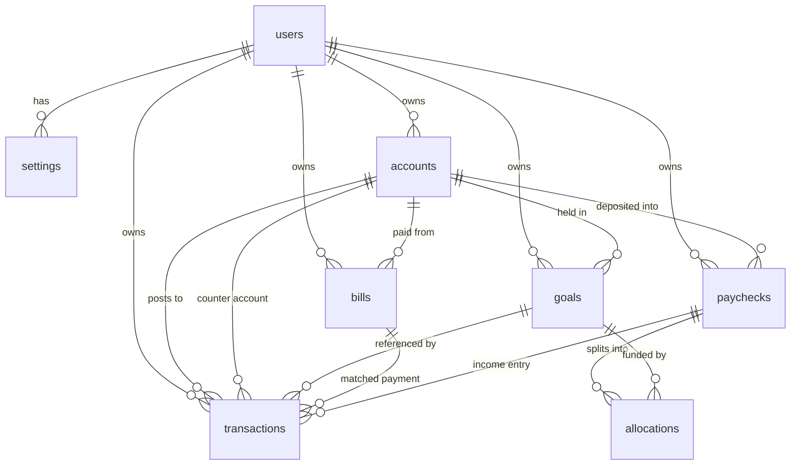

# Data model

WageRoute stores everything in one SQLite database, `wageroute.db`, using `STRICT` tables, integer cents, UUID text keys and ISO-8601 timestamps. This document describes the schema at version 3, the semantics of each column, the derived values the app computes at read time, and the invariants that keep the ledger coherent.

Source of truth: [`src/main/db/migrations.ts`](../src/main/db/migrations.ts). Read model assembly: [`src/main/db/repositories.ts`](../src/main/db/repositories.ts).

---

## Contents

- [Conventions](#conventions)
- [Entity relationships](#entity-relationships)
- [Tables](#tables)
- [Indexes](#indexes)
- [Derived values](#derived-values)
- [Settings keys](#settings-keys)
- [Migrations](#migrations)
- [Invariants](#invariants)
- [Retention and soft deletes](#retention-and-soft-deletes)
- [Limits and exclusions](#limits-and-exclusions)
- [Sync-readiness](#sync-readiness)

---

## Conventions

| Concern | Rule |
| --- | --- |
| Identity | UUIDv4 text generated on-device by `randomUUID()` |
| Money | `INTEGER` cents. No floats, no mixed-currency columns |
| Dates | `YYYY-MM-DD` text, no time or zone |
| Timestamps | ISO-8601 UTC text, e.g. `2026-10-27T18:22:04.871Z` |
| Deletes | Soft: `deleted_at` is set, rows remain |
| Change tracking | `revision` increments on every update and soft delete |
| Tenant key | `user_id` on every financial table |
| Storage | SQLite `STRICT` tables; booleans are `INTEGER` constrained to 0/1 |
| Foreign keys | Enforced per connection (`PRAGMA foreign_keys = ON`) |
| Table names | Plural snake_case |
| Column names | Snake_case; repositories alias to camelCase for TypeScript |

### Sign conventions

There is no database-level sign constraint on `transactions.amount_cents`. Direction is carried by the sign and intent by `kind`:

| Kind | Typical sign | Meaning |
| --- | --- | --- |
| `income` | positive | Money in |
| `expense` | negative | Discretionary spending |
| `bill_payment` | negative | Priority Wall bill paid |
| `transfer` | one negative, one positive | Paired account move |
| `goal_funding` | positive or negative | Manual goal-related entry; does not change goal progress |
| `investment` | positive or negative | Investment contribution/withdrawal |
| `adjustment` | either | Balance correction |

The UI normalises income to positive and expense/bill payment to negative when creating entries. The repository accepts any non-zero signed amount for every kind, because imports and adjustments need that freedom.

## Entity relationships



Cardinality in practice: one local user, many accounts/bills/goals/paychecks/transactions; each paycheck has zero or more allocation rows; each transaction optionally references a bill, goal, paycheck and counter-account.

## Tables

### `users`

The local profile. Exactly one active row is expected; the app never creates a second user.

| Column | Type | Constraints | Notes |
| --- | --- | --- | --- |
| `id` | TEXT | PK, NOT NULL | UUID |
| `email` | TEXT | nullable | Never used for auth or network |
| `display_name` | TEXT | NOT NULL | Shown in the dashboard greeting |
| `currency` | TEXT | NOT NULL, default `'USD'` | Legacy copy; the UI reads currency from settings |
| `created_at` | TEXT | NOT NULL | |
| `updated_at` | TEXT | NOT NULL | |
| `deleted_at` | TEXT | nullable | |
| `revision` | INTEGER | NOT NULL, default 1 | |

The seed creates `display_name = 'Alex'` with `currency = 'USD'`.

### `settings`

A key/value store for application preferences. Unlike other tables it has no surrogate ID, no `deleted_at` and no `revision`.

| Column | Type | Constraints | Notes |
| --- | --- | --- | --- |
| `user_id` | TEXT | NOT NULL, FK `users(id)` ON DELETE CASCADE | |
| `key` | TEXT | NOT NULL | |
| `value` | TEXT | NOT NULL | Everything is stored as text |
| `updated_at` | TEXT | NOT NULL | |
| — | — | `PRIMARY KEY (user_id, key)` | Upserts use this conflict target |

Writes use `INSERT ... ON CONFLICT(user_id, key) DO UPDATE`. Reads return the raw record; `parseSettings` validates and clamps it. See [Settings keys](#settings-keys).

### `accounts`

| Column | Type | Constraints | Notes |
| --- | --- | --- | --- |
| `id` | TEXT | PK | |
| `user_id` | TEXT | NOT NULL, FK users | |
| `name` | TEXT | NOT NULL | Display name, used for CSV matching |
| `kind` | TEXT | NOT NULL, CHECK in `checking,savings,cash,investment,credit` | |
| `institution` | TEXT | nullable | Bank grouping, e.g. Tangerine |
| `starting_balance_cents` | INTEGER | NOT NULL, default 0 | Opening balance |
| `credit_limit_cents` | INTEGER | nullable, CHECK null or ≥ 0 | Added in v3; credit cards only in practice |
| `is_archived` | INTEGER | NOT NULL, default 0, CHECK 0/1 | |
| `sort_order` | INTEGER | NOT NULL, default 0 | |
| `created_at` | TEXT | NOT NULL | |
| `updated_at` | TEXT | NOT NULL | |
| `deleted_at` | TEXT | nullable | |
| `revision` | INTEGER | NOT NULL, default 1 | |

Semantics:

- A credit card's opening debt is stored as a **negative** starting balance. The account dialog asks for a positive “balance owed” and negates it.
- The current balance is derived: `starting_balance_cents + SUM(non-deleted transactions for the account)`.
- Archived accounts remain in the snapshot but are excluded from cash, credit totals and most pickers.
- Deleting nulls `bills.account_id`, `goals.account_id` and `paychecks.deposit_account_id` before soft-deleting the account. Transactions are kept.

### `bills`

| Column | Type | Constraints | Notes |
| --- | --- | --- | --- |
| `id` | TEXT | PK | |
| `user_id` | TEXT | NOT NULL, FK users | |
| `name` | TEXT | NOT NULL | |
| `amount_cents` | INTEGER | NOT NULL, CHECK > 0 | Per occurrence, not monthly |
| `frequency` | TEXT | NOT NULL, CHECK in `weekly,biweekly,semimonthly,monthly,quarterly,annual` | |
| `due_day` | INTEGER | NOT NULL, CHECK 1–31 | Day of month; clamped when computing |
| `category` | TEXT | NOT NULL, default `'Bills'` | |
| `account_id` | TEXT | nullable, FK accounts | Where it is paid from |
| `autopay` | INTEGER | NOT NULL, default 0, CHECK 0/1 | Informational |
| `is_active` | INTEGER | NOT NULL, default 1, CHECK 0/1 | Paused bills stop reserving |
| `next_due_on` | TEXT | nullable | Optional explicit anchor for projections |
| `created_at` | TEXT | NOT NULL | |
| `updated_at` | TEXT | NOT NULL | |
| `deleted_at` | TEXT | nullable | |
| `revision` | INTEGER | NOT NULL, default 1 | |

`next_due_on` is not advanced automatically when a bill is marked paid. Projections use it only when it is on or after the projection start date; otherwise they derive the next occurrence from `due_day`.

### `goals`

| Column | Type | Constraints | Notes |
| --- | --- | --- | --- |
| `id` | TEXT | PK | |
| `user_id` | TEXT | NOT NULL, FK users | |
| `name` | TEXT | NOT NULL | |
| `target_cents` | INTEGER | NOT NULL, CHECK > 0 | |
| `target_date` | TEXT | nullable | Optional deadline |
| `priority` | INTEGER | NOT NULL, default 100 | Lower is funded first |
| `color` | TEXT | NOT NULL, default `'#34D399'` | Hex string used by the UI |
| `account_id` | TEXT | nullable, FK accounts | Informational “held in” |
| `is_emergency` | INTEGER | NOT NULL, default 0, CHECK 0/1 | Added in v3 |
| `is_archived` | INTEGER | NOT NULL, default 0, CHECK 0/1 | |
| `created_at` | TEXT | NOT NULL | |
| `updated_at` | TEXT | NOT NULL | |
| `deleted_at` | TEXT | nullable | |
| `revision` | INTEGER | NOT NULL, default 1 | |

Goal progress is **not** stored. It is derived from allocations:

```sql
SUM(allocations.amount_cents)
WHERE goal_id = ? AND bucket = 'goal' AND deleted_at IS NULL
```

Consequences:

- `fundedCents` only increases through paycheck routing.
- A manual `goal_funding` transaction does not fund a goal.
- A goal's held-in account balance is unrelated to its funded amount. The app tracks intent, not ring-fenced cash.

### `paychecks`

| Column | Type | Constraints | Notes |
| --- | --- | --- | --- |
| `id` | TEXT | PK | |
| `user_id` | TEXT | NOT NULL, FK users | |
| `amount_cents` | INTEGER | NOT NULL, CHECK > 0 | Gross deposit |
| `received_on` | TEXT | NOT NULL | Pay date |
| `source` | TEXT | NOT NULL, default `'Paycheck'` | Free text |
| `deposit_account_id` | TEXT | nullable, FK accounts | |
| `priority_cents` | INTEGER | NOT NULL, default 0 | Funded wall amount |
| `surplus_cents` | INTEGER | NOT NULL, default 0 | Income minus funded wall |
| `leisure_cents` | INTEGER | NOT NULL, default 0 | Residual |
| `health` | TEXT | NOT NULL, CHECK in `covered,tight,shortfall` | Snapshot of plan status |
| `created_at` | TEXT | NOT NULL | |
| `updated_at` | TEXT | NOT NULL | |
| `deleted_at` | TEXT | nullable | |
| `revision` | INTEGER | NOT NULL, default 1 | |

A paycheck row is an audit record of a routing decision. It is written only by `commitPaycheck` or by the seed. Each commit also writes an `income` transaction on the deposit account, unless the record is seeded with `recordIncome = false`.

### `allocations`

| Column | Type | Constraints | Notes |
| --- | --- | --- | --- |
| `id` | TEXT | PK | |
| `user_id` | TEXT | NOT NULL, FK users | |
| `paycheck_id` | TEXT | NOT NULL, FK paychecks ON DELETE CASCADE | |
| `bucket` | TEXT | NOT NULL, CHECK in `priority,savings,investment,goal,debt,leisure` | `debt` added in v2 |
| `goal_id` | TEXT | nullable, FK goals | Set only for `goal` |
| `label` | TEXT | NOT NULL | Human-readable line |
| `amount_cents` | INTEGER | NOT NULL, CHECK ≥ 0 | Zero-value lines are not inserted |
| `created_at` | TEXT | NOT NULL | |
| `updated_at` | TEXT | NOT NULL | |
| `deleted_at` | TEXT | nullable | |
| `revision` | INTEGER | NOT NULL, default 1 | |

Allocation rows are plan lines. They do not alter account balances. Only `goal` rows with a `goal_id` contribute to goal progress.

### `transactions`

The ledger. Every balance in the app is derived from this table.

| Column | Type | Constraints | Notes |
| --- | --- | --- | --- |
| `id` | TEXT | PK | |
| `user_id` | TEXT | NOT NULL, FK users | |
| `account_id` | TEXT | NOT NULL, FK accounts | Posting account |
| `kind` | TEXT | NOT NULL, CHECK in `income,expense,bill_payment,transfer,goal_funding,investment,adjustment` | |
| `amount_cents` | INTEGER | NOT NULL | Signed cents |
| `occurred_on` | TEXT | NOT NULL | `YYYY-MM-DD` |
| `memo` | TEXT | NOT NULL, default `''` | Description shown in the UI |
| `category` | TEXT | NOT NULL, default `'Uncategorized'` | Free text |
| `bill_id` | TEXT | nullable, FK bills | Links a payment to a bill prompt |
| `goal_id` | TEXT | nullable, FK goals | Informational link only |
| `paycheck_id` | TEXT | nullable, FK paychecks | Links the income entry |
| `counter_account_id` | TEXT | nullable, FK accounts | Other side of a transfer |
| `transfer_group_id` | TEXT | nullable | Added in v3; shared by both legs |
| `created_at` | TEXT | NOT NULL | |
| `updated_at` | TEXT | NOT NULL | |
| `deleted_at` | TEXT | nullable | |
| `revision` | INTEGER | NOT NULL, default 1 | |

Transfer rules:

- A transfer always writes exactly two rows, in one SQL transaction.
- The posting account gets a negative leg, the counter account a positive leg.
- Both legs share a new `transfer_group_id` and point at each other through `counter_account_id`.
- Editing a paired leg may change amount magnitude, date, memo and category. It may not change account or kind; the UI edits the sibling leg in the same transaction.
- Deleting either leg soft-deletes the whole group.
- Round-up sweeps use the same paired-transfer structure, so deleting a round-up leg deletes both.

`goal_funding` and `investment` are available kinds for manual entries, but neither changes goal progress nor the allocator's investment bucket. They are ledger labels, not routing records.

## Indexes

| Index | Definition | Purpose |
| --- | --- | --- |
| `idx_accounts_sync` | `accounts(user_id, updated_at)` | Future pull cursor |
| `idx_bills_sync` | `bills(user_id, updated_at)` | Future pull cursor |
| `idx_goals_sync` | `goals(user_id, updated_at)` | Future pull cursor |
| `idx_paychecks_user` | `paychecks(user_id, received_on DESC)` | Newest paychecks |
| `idx_allocations_paycheck` | `allocations(paycheck_id)` | Assemble paycheck details |
| `idx_allocations_goal` | `allocations(goal_id) WHERE deleted_at IS NULL` | Goal progress |
| `idx_transactions_sync` | `transactions(user_id, updated_at)` | Future pull cursor |
| `idx_transactions_account` | `transactions(account_id, occurred_on DESC) WHERE deleted_at IS NULL` | Account-ledger reads |
| `idx_transactions_user_date` | `transactions(user_id, occurred_on DESC) WHERE deleted_at IS NULL` | Snapshot ordering |
| `idx_transactions_transfer_group` | `transactions(transfer_group_id) WHERE transfer_group_id IS NOT NULL` | Find both transfer legs |

## Derived values

None of the following are stored. They are recomputed from rows.

| Value | Formula | Where |
| --- | --- | --- |
| Account balance | `starting_balance_cents + SUM(t.amount_cents)` for non-deleted rows | `listAccounts` |
| Cash on hand | Sum of non-archived `checking`, `savings`, `cash` balances | `finance.ts` |
| Credit owed | `SUM(max(0, −balance))` for non-archived credit accounts | `finance.ts` |
| Credit available | `SUM(max(0, limit − owed))` per credit account with a limit | `finance.ts` |
| Credit display | `max(0, −balance)` | `finance.ts` |
| Goal funded | `SUM(allocations.amount_cents)` where bucket `goal`, matching goal, non-deleted | `listGoals` |
| Goal remaining | `max(0, target_cents − fundedCents)` | `listGoals` |
| Monthly wall | `SUM(round(amount × billPeriodsPerYear / 12))` over active bills | `cadence.ts` |
| Per-paycheck wall | `SUM(round(amount × billPeriodsPerYear / payPeriodsPerYear))` | `cadence.ts` |
| Safe to Spend | Cash on hand − monthly wall − funded sinking goals | `useFinanceStore.ts` |
| Months to goal | `max(1, ceil(daysUntil / 30.4375))` | `dates.ts` |
| Monthly goal pace | `ceil(remaining / months)` | `Goals.tsx` |
| Month routing donut | Priority; savings+investment+goal folded as growth; debt; leisure | `finance.ts` |
| Emergency essentials | `monthly wall + (includeVariable ? average variable : 0)` | `emergency.ts` |
| Emergency target | `essentials × months` (or manual cents) | `emergency.ts` |
| Emergency coverage | `funded / essentials` | `emergency.ts` |
| Round-up sweep | `increment − (|amount| mod increment)`, zero when divisible | `transfers.ts` |

### Transaction limits

`getSnapshot` reads at most **500 transactions** and **24 paychecks**. All UI totals that use the snapshot therefore see that window:

- the ledger grid and CSV export use the 500-row window;
- month-to-date routing and the last-paycheck card use the 24-paycheck window;
- account balances, goal progress and emergency averages are computed in SQL or over the returned rows and are affected by these limits where noted.

JSON backup is not limited: it queries every row for the user.

## Settings keys

Stored in `settings.value` as text. Defaults and validation live in `src/shared/settings.ts`.

| Key | Type | Default | Validation / behaviour |
| --- | --- | --- | --- |
| `currency` | string | `USD` | Must match `^[A-Z]{3}$`; no in-app selector today |
| `payCadence` | enum | `biweekly` | `weekly`, `biweekly`, `semimonthly`, `monthly` |
| `savingsPercent` | number | `20` | Clamped to 0–100, rounded |
| `investmentPercent` | number | `15` | Clamped to 0–100, rounded |
| `goalsPercent` | number | `15` | Clamped to 0–100, rounded |
| `debtPercent` | number | `0` | Clamped to 0–100, rounded |
| `wholeDollarBuckets` | boolean | `true` | Only the string `"true"` is true |
| `theme` | enum | `dark` | `dark`, `light`, `system` |
| `roundUpEnabled` | boolean | `false` | |
| `roundUpAccountId` | string | `null` / empty | Any non-empty string is accepted; destination is re-validated at write time |
| `roundUpToCents` | enum number | `100` | Only `100`, `200`, `500` |
| `emergencyMode` | enum | `auto` | `auto`, `manual` |
| `emergencyMonths` | number | `3` | Integer 1–12, else 3 |
| `emergencyIncludeVariable` | boolean | `true` | |
| `emergencyManualTargetCents` | number | `0` | Positive integer, else 0 |

Unknown keys are preserved by an import but ignored by `parseSettings`. Settings imported from a backup never overwrite existing local keys (`INSERT OR IGNORE`).

The seed overrides the default splits to `20 / 15 / 15 / 5` and leaves 45% as leisure.

## Migrations

Migrations run inside a transaction per version and are tracked by `PRAGMA user_version`. They only move forward.

| Version | Change | Why |
| --- | --- | --- |
| **1** | Creates `users`, `settings`, `accounts`, `bills`, `goals`, `paychecks`, `allocations`, `transactions` and all indexes | Initial schema |
| **2** | Rebuilds `allocations` to add `debt` to the bucket CHECK | SQLite cannot alter a CHECK constraint; the table is copied, dropped and renamed |
| **3** | Adds `accounts.credit_limit_cents`, `goals.is_emergency`, `transactions.transfer_group_id`, a transfer-group index, and flags existing goals named “Emergency Fund” | Credit tracking, emergency fund, paired transfers |

`SCHEMA_VERSION` is derived from the last migration and is reported in JSON backups. Backups with a higher version are rejected. Backups older than version 2 are rejected; versions 2 and 3 are accepted.

Migration procedure for future work is in [DEVELOPMENT.md](DEVELOPMENT.md#adding-a-schema-migration).

## Invariants

These should hold after every successful mutation.

1. **Plan balance.** For a committed paycheck:
   `priority_cents + savings + investment + goal allocations + debt + leisure === amount_cents`.
2. **Paycheck income.** `priority_cents + surplus_cents === amount_cents`; `leisure_cents` is the unallocated part of the surplus.
3. **Transfer pairing.** Every row with a `transfer_group_id` has exactly one sibling with the same group and the opposite sign, unless one leg has been soft-deleted (both are deleted together by the app).
4. **Amount sign.** Income is positive and expenses/bill payments are negative when created through the UI; adjustments and manual ledger edits may use either sign.
5. **Positive targets.** `bills.amount_cents > 0` and `goals.target_cents > 0` are enforced by the schema.
6. **Non-negative allocation.** `allocations.amount_cents >= 0`.
7. **Goal funding.** `fundedCents = SUM(goal allocations)`; a goal cannot be “funded” by editing its target or its account balance.
8. **Soft delete visibility.** All list queries filter `deleted_at IS NULL`; snapshots never include deleted rows.
9. **One local user.** `getLocalUserId` selects the earliest non-deleted user.
10. **Currency display.** Every formatted amount uses `settings.currency`, not `users.currency`.

## Retention and soft deletes

| Action | What happens |
| --- | --- |
| Delete account | References nulled; account soft-deleted; transactions retained |
| Delete bill | Bill soft-deleted; past payments and prompts disappear |
| Delete goal | Goal soft-deleted; allocations retained but no longer shown as progress |
| Delete transaction | Row soft-deleted; if paired, both legs are soft-deleted |
| Delete paycheck | No delete path in the UI |
| Clear all data | No in-app path; remove the database file manually |

Soft-deleted rows are included in JSON backups, so a backup taken before a delete still contains the tombstone. Importing it into the same database skips the existing ID; it does not resurrect the row.

## Limits and exclusions

| Limit | Value | Source |
| --- | --- | --- |
| Snapshot transactions | 500 newest | `listTransactions` |
| Snapshot paychecks | 24 newest | `listPaychecks` |
| Import file size | 64 MiB | `ipc.ts` |
| Rows per JSON table | 200,000 | `backup.ts` |
| Projection horizon | 90 days | `Spreadsheet.tsx` |
| Projection guard per bill | 400 occurrences | `projections.ts` |
| Text fields | 160 chars default; memo 240; category/color 60/20 | `repositories.ts` |
| Bill due day | 1–31, clamped | schema + repository |

Not in the backup: the `users` row (display name, email, legacy currency), the database file itself, the theme cache in `localStorage`, and the `snoozedBillIds` session state.

## Sync-readiness

The schema was designed so a future sync layer can be added without reshaping the ledger:

- UUID keys let offline devices create rows independently;
- `user_id` is ready to become a tenant key;
- `updated_at` is a pull cursor;
- `revision` supports last-write-wins;
- `deleted_at` provides tombstones;
- money is integer-only;
- IDs are preserved by JSON import.

Missing pieces for real sync: an auth/identity model, a server, an outbox table, `synced_at` columns, conflict policy beyond last-write-wins, per-device cursors, encryption in transit and at rest, and a migration strategy across devices. None of it is implemented. See [DEPLOYMENT.md](DEPLOYMENT.md#sync-status).
